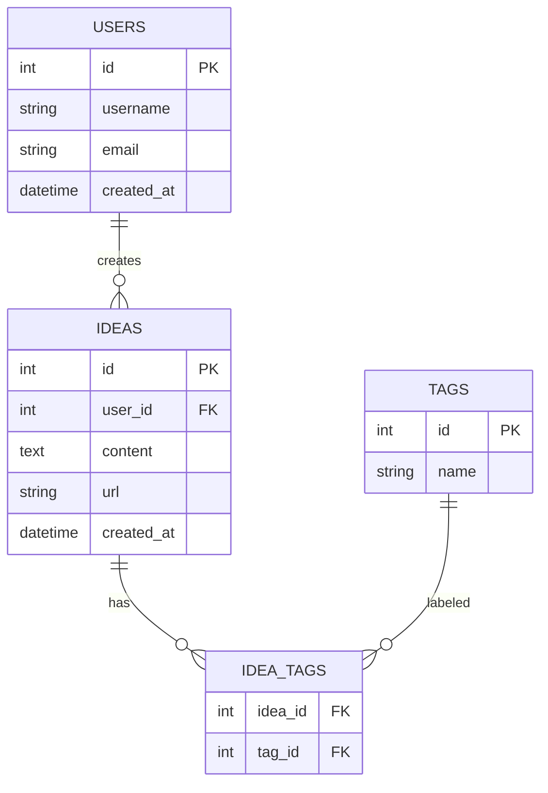
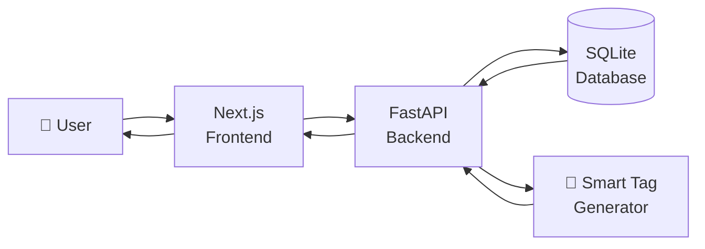

# IDEA VAULT:

## The Correct Model: Build-First, Learn-When-Stuck

Here's how your 6 days actually look:

### 1 — "I want to build an idea vault"
- Open Cursor. Start a project.
- **Stuck:** "How do I save ideas?"
- **Learn:** What a database is, `CREATE TABLE`, `INSERT`, `SELECT`. 30 minutes, not 4 hours.
- **Build:** Create `ideas` table, insert one idea, read it back.
- **Stuck:** "How do I write this in a file?"
- **Learn:** `sql-practice.sql`, how to run it.
- **Build:** Save your queries.
- **Stuck:** "How do I not lose this work?"
- **Learn:** `git init`, `git add`, `git commit`. 15 minutes.
- **Build:** Commit.
- **Done for the day.** You learned SQL, Git, and databases — *by building*.

### 2 — "I want tags on my ideas"
- **Stuck:** "One idea can have many tags, one tag can belong to many ideas. How?"
- **Learn:** Many-to-many relationship, junction table.
- **Build:** `tags` table + `idea_tags` table. Write JOIN queries.
- **Stuck:** "My queries are getting complex."
- **Learn:** `INNER JOIN`, `GROUP BY`. 20 minutes.
- **Build:** Finish the 20 queries.
- **Commit.**
- **Done.** You learned intermediate SQL — *by building*.

###  3 — "I want this to be an actual API"
- **Stuck:** "How do I make an API in Python?"
- **Learn:** FastAPI basics — `@app.get()`, `@app.post()`. 1 hour.
- **Build:** `GET /ideas`, `POST /ideas`.
- **Stuck:** "Python syntax is weird."
- **Learn:** Just the syntax you need — functions, dicts, f-strings.
- **Build:** Finish the endpoints.
- **Commit.**
- **Done.** You learned Python + FastAPI — *by building*.

###  4 — "The smart tag endpoint"
- **Stuck:** "How do I generate tags?"
- **Learn:** String manipulation, or how to call an LLM API. 30 minutes.
- **Build:** `POST /ideas/{id}/generate-tags`.
- **Stuck:** "I want a UI now."
- **Learn:** React basics — components, `useState`. 1 hour.
- **Build:** A basic dashboard.
- **Commit.**
- **Done.**

###  5 — "Make it look good + filter"
- **Stuck:** "How do I filter by tag?"
- **Learn:** React state, conditional rendering. 30 minutes.
- **Build:** Filter component.
- **Stuck:** "CORS error!"
- **Learn:** What CORS is, `CORSMiddleware`. 20 minutes.
- **Build:** Fix it. **Log it in AI_JOURNAL.**
- **Commit.**

###  6 — "Prove it works"
- **Stuck:** "How do I test an API?"
- **Learn:** Postman basics. 1 hour.
- **Build:** 10+ requests.
- **Stuck:** "How do I write test cases?"
- **Learn:** Test case structure, severity vs priority. 30 minutes.
- **Build:** `test-cases.md`, `bug-reports.md`.
- **Commit. Push. Done.**

---

## The Rule: Learn Only When You Have a Specific Problem

**Bad question:** "What should I learn today?"
**Good question:** "What do I want to build today, and what's blocking me?"

The block tells you what to learn. Nothing else.

# Idea Vault — Flowchart( first iteration)


---

## 📐 System Architecture


# Breaking Down Every Term (Plain English)

Let me explain each one like you've never seen it before.

---

## 1. "Rendered UI"

**UI** = User Interface = **what the user sees on screen**.

**Rendered** = drawn/painted on screen by the browser.

**"Rendered UI"** = the final visual output the user looks at — buttons, text, cards, forms.

### Simple Example

You write this in React:
```jsx
<h1>My Idea Vault</h1>
<p>3 ideas saved</p>
```

The browser **renders** it into:
> **My Idea Vault**
> 3 ideas saved

**Before rendering:** raw code (HTML/JSX)
**After rendering:** pixels on screen that human eyes can see

### Analogy
- **Raw HTML/JSX** = architect's blueprint
- **Rendered UI** = the actual house you walk into

The flowchart arrow `FE -->|Rendered UI| User` means: **"The frontend sends the finished visual to the user's screen."**

---

## 2. `Frontend :3000` (the `:3000` part)

The `:3000` is a **port number**.

### What's a Port?

Think of your computer like a **big apartment building**.
- The **IP address** (`localhost` or `192.168.1.5`) = the building's street address
- The **port number** (`:3000`, `:8000`) = the **apartment number**

Multiple apps run on the same computer, each in a different "apartment."

### Why `:3000` for Frontend?

Next.js (and most React dev servers) **default to port 3000**. So when you run:
```bash
npm run dev
```

You see:
```
▲ Next.js ready on http://localhost:3000
```

You open that URL in your browser → you see your frontend.

**`localhost:3000`** = "this computer, apartment 3000 = Next.js frontend"

You could change it, but `:3000` is the convention. Just leave it.

---

## 3. `Backend :8000` (the `:8000` part)

Same idea — a port number for the backend.

### Why `:8000` for Backend?

FastAPI + uvicorn (the server that runs FastAPI) **defaults to port 8000**. When you run:
```bash
uvicorn main:app --reload
```

You see:
```
Uvicorn running on http://127.0.0.1:8000
```

You open that URL → you see FastAPI's auto-generated docs at `/docs`.

**`localhost:8000`** = "this computer, apartment 8000 = FastAPI backend"

### Why Different Ports?

Because **both apps run at the same time on your machine.**

- `localhost:3000` → Next.js (the UI)
- `localhost:8000` → FastAPI (the data/logic)

Your browser talks to `:3000` to show the UI. The UI talks to `:8000` to get data.

### Analogy
- `:3000` = the **showroom** (where customers walk in)
- `:8000` = the **warehouse** (where the products are stored)

The showroom (frontend) calls the warehouse (backend) to fetch products (data).

---

## 4. CORS Middleware

Two words to unpack: **CORS** and **Middleware**.

### What is CORS?

**CORS = Cross-Origin Resource Sharing**

It's a **browser security rule**: "Should this website be allowed to talk to that other website?"

### The "Origin" Concept

An **origin** = `protocol + domain + port`

| URL | Origin |
|-----|--------|
| `http://localhost:3000` | `http://localhost:3000` |
| `http://localhost:8000` | `http://localhost:8000` |
| `https://google.com` | `https://google.com` |

Two URLs have the **same origin** only if protocol, domain, AND port all match.

### The Problem

- Your frontend runs at `localhost:3000`
- Your backend runs at `localhost:8000`
- **Different ports → different origins**

When the frontend tries to fetch data from the backend, the **browser blocks it** by default:

> ❌ **CORS error: Access to fetch at 'http://localhost:8000/ideas' from origin 'http://localhost:3000' has been blocked by CORS policy.**

This is a **browser** rule, not a server rule. It exists so that `evil-website.com` can't silently call `your-bank.com/api/transfer-money` using your logged-in cookies.

### What is Middleware?

**Middleware** = code that runs **between** the request and your actual endpoint. It can inspect, modify, or block requests.

```
Request → [Middleware 1] → [Middleware 2] → Your endpoint → Response
```

### CORS Middleware

FastAPI has a built-in middleware that **adds special headers** to every response saying: *"It's OK for localhost:3000 to call me."*

```python
from fastapi.middleware.cors import CORSMiddleware

app.add_middleware(
    CORSMiddleware,
    allow_origins=["http://localhost:3000"],  # who can call me
    allow_methods=["*"],                       # GET, POST, DELETE, etc.
    allow_headers=["*"],                       # which headers allowed
)
```

Once added, the browser sees those headers and says: *"OK, this is allowed."* CORS error disappears.

### Why This Matters for Your Project

**You WILL hit this error.** It's practically guaranteed when connecting Next.js to FastAPI. It's the #1 beginner roadblock.

The document mentions it specifically:
> *"AI hallucinations or errors (e.g., CORS blunders)"*

**Log it in `AI_JOURNAL.md`.** It's proof you debugged a real-world problem.

---

## 5. Mock NLP

Two words: **Mock** and **NLP**.

### What is NLP?

**NLP = Natural Language Processing**

It's the field of AI that deals with **human language**: text, speech.

Examples:
- ChatGPT understanding your question → NLP
- Google Translate → NLP
- Siri understanding "set a timer" → NLP
- Gmail detecting spam → NLP

**For your project:** given a sentence like *"Build a habit tracker app"*, NLP would **figure out the topic** and suggest tags like `#productivity`, `#health`.

### What is "Mock"?

**Mock** = fake, simulated, pretend.

A **mock NLP** = **fake NLP.** It *looks* like it understands language, but it's just simple rules.

### Real NLP vs Mock NLP

**Real NLP (using OpenAI API):**
```python
response = openai.chat.completions.create(
    model="gpt-4o-mini",
    messages=[{"role": "user", "content": "Suggest 3 tags for: Build a habit tracker app"}]
)
# → "health, productivity, habit-formation"  ← AI actually understood
```

**Mock NLP (simple keyword matching):**
```python
def generate_tags(text):
    tags = []
    if "habit" in text.lower():
        tags.append("health")
    if "app" in text.lower():
        tags.append("side-project")
    if "read" in text.lower() or "article" in text.lower():
        tags.append("reading")
    return tags[:3]

# "Build a habit tracker app" → ["health", "side-project"]
```

The mock version isn't smart. It just checks for keywords. But it **behaves like** NLP — you feed it text, it returns tags.

### Why Use Mock NLP?

| Reason | Explanation |
|--------|-------------|
| **Free** | No API key, no billing |
| **Fast** | No network call, instant response |
| **Reliable** | Doesn't fail when internet is down |
| **Simple** | 10 lines of Python |
| **Good enough** | For a learning project, this satisfies the requirement |

### The Document Says:

> *"auto-generates 2-3 tags for new ideas (via mock NLP or an LLM API)"*

So you have **two choices**:
1. **Mock NLP** → free, simple, no API key needed ✅ **recommended**
2. **Real LLM API** → cooler, smarter, but needs OpenAI/Anthropic API key + costs money

**Pick mock NLP for the project.** It's fully sufficient and hits the requirement.

---

## Summary Table

| Term | Plain English | Why It Matters |
|------|---------------|----------------|
| **Rendered UI** | What the user sees on screen after React draws it | The final output of your frontend |
| **`:3000`** | Port number = "apartment 3000" where Next.js lives | Convention for React/Next.js |
| **`:8000`** | Port number = "apartment 8000" where FastAPI lives | Convention for FastAPI |
| **CORS Middleware** | Security rule + code that allows cross-origin requests | You WILL hit this. Log it. |
| **Mock NLP** | Fake AI that uses keyword rules to generate tags | Free, simple way to hit the "smart" requirement |

---

## The Full Picture (One Sentence Each)

1. **Frontend** at `:3000` builds the **rendered UI** the user sees
2. **Backend** at `:8000` serves data via API
3. **CORS middleware** lets the frontend (`:3000`) talk to the backend (`:8000`)
4. **Mock NLP** generates fake-smart tags when you save an idea

That's your entire app in 4 lines. Everything else is detail.

---

Want me to show you the **actual code** for a working CORS setup + mock NLP function that you can paste into your FastAPI app?

---

## 🔄 User Flow


---

## 🗄️ Database Schema



---

## ⚡ Simple Linear Overview



---


# START

# Let's Start. Right Now. Day 1.

Forget the whole 6-day plan for a second. **We're only doing today.** Here's exactly what to do, step by step, in order.

---

## Before You Touch Code: 5-Minute Setup Check

Answer these in your head:

- [ ] Do you have **Python** installed? (`python --version` in terminal)
- [ ] Do you have **Node.js** installed? (`node --version`)
- [ ] Do you have **Git** installed? (`git --version`)
- [ ] Do you have **Cursor** or **Windsurf** installed? (AI editor)
- [ ] Do you have a **GitHub account**?

If any is missing, install it first. Reply and I'll walk you through whichever is missing.

If all ✅ → proceed below.

---

## Day 1 Goal (Only One Goal)

> **By end of today: a GitHub repo called `idea-vault` with 3 files committed, and a clear picture of what you're building.**

That's it. No code. No FastAPI. No React. **Just setup + planning + first commit.**

Why so small? Because **momentum > ambition**. A committed repo on Day 1 is a psychological win. Skipping this and jumping to code is why 90% of people quit by Day 3.

---

## Step 1: Create the Project Folder (2 min)

Open your terminal. Run these **exactly**:

```bash
mkdir idea-vault
cd idea-vault
```

You're now inside an empty folder called `idea-vault`.

---

## Step 2: Initialize Git (1 min)

```bash
git init
```

You'll see: `Initialized empty Git repository in .../idea-vault/.git/`

That's it. Git is now tracking this folder.

---

## Step 3: Create Your First 3 Files (10 min)

You need exactly **3 files** today:

### File 1: `README.md`

Create the file and paste this:

```markdown
# 💡 Idea Vault

A personal app to save ideas and links, auto-tag them, and filter by tag.

## Tech Stack
- **Backend:** FastAPI (Python)
- **Frontend:** Next.js (React)
- **Database:** SQLite (dev) → PostgreSQL (prod)
- **AI:** Mock NLP for tag generation

## Status
🚧 Day 1 — Project setup

## Architecture


## Deliverables Checklist
- [ ] Day 1: Setup + notes
- [ ] Day 2: Database schema
- [ ] Day 3: Python + FastAPI basics
- [ ] Day 4: Backend complete
- [ ] Day 5: Frontend complete
- [ ] Day 6: Tests + docs
```

### File 2: `notes/day1.md`

First create the folder: `mkdir notes`

Then create `notes/day1.md`:

```markdown
# Day 1 Notes — [Your Name], 17 Oct 2026

## What I Set Up Today
- Created `idea-vault` repo
- Initialized Git
- Wrote README + architecture diagram

## What I Learned
- Git basics: `git init`, `git add`, `git commit`
- How the web works: browser (client) → API (server) → database
- HTTP methods: GET (read), POST (create), DELETE (remove)

## What I'm Building
A personal "Idea Vault" — save ideas/URLs, auto-tag them, filter by tag.

## What Confused Me (so far)
1. What exactly does CORS mean?
2. How do frontend and backend talk to each other?
3. What is a port number?
```

### File 3: `.gitignore`

This is **critical** — prevents committing junk. Create `.gitignore`:

```
# Python
__pycache__/
*.pyc
venv/
.env

# Node
node_modules/
.next/
out/

# Databases
*.db
*.sqlite

# OS
.DS_Store
Thumbs.db

# IDE
.vscode/
.idea/
```

**Why this matters:** Without `.gitignore`, you'll commit `node_modules` (500MB of junk), API keys (security disaster), and cache files. **Do this now, not later.**

---

## Step 4: Your First Commit (2 min)

```bash
git add .
git commit -m "Day 1: Initial project setup with README and notes"
```

Check it worked:

```bash
git log
```

You should see your commit.

**🎉 You just made your first commit. This is Deliverable #1 (part 1 of 3) done.**

---

## Step 5: Push to GitHub (5 min)

### 5a. Create the repo on GitHub

1. Go to [github.com/new](https://github.com/new)
2. **Repository name:** `idea-vault`
3. **Visibility:** Public (recruiters can see it) or Private (only you)
4. **DO NOT** check "Add a README" (you already have one)
5. Click **Create repository**

### 5b. Connect local → GitHub

GitHub shows you commands. They look like:

```bash
git remote add origin https://github.com/YOUR_USERNAME/idea-vault.git
git branch -M main
git push -u origin main
```

Copy-paste them one by one. Replace `YOUR_USERNAME` with your actual GitHub username.

### 5c. Verify

Refresh the GitHub page. You should see:
- `README.md` (with a rendered flowchart!)
- `notes/day1.md`
- `.gitignore`

**🎉 Your project is now live on GitHub.** Send yourself the link.

---

## Step 6: Read One Thing (10 min, no videos)

You said no videos — good. **Read** this one short article:

👉 **"How the Web Works" — MDN** → [https://developer.mozilla.org/en-US/docs/Learn/Getting_started_with_the_web/How_the_Web_works](https://developer.mozilla.org/en-US/docs/Learn/Getting_started_with_the_web/How_the_Web_works)

Just read it. Don't take notes. Don't watch anything. It's 5 minutes.

**Why?** Because tomorrow you'll build an API, and you need a mental model of client → server → response. That's the only concept you need today.

---

## What You Have Now

By end of Day 1, you have:

✅ A Git repo called `idea-vault`
✅ A README with an architecture diagram
✅ Day 1 notes committed
✅ A `.gitignore` protecting you from future mistakes
✅ Everything pushed to GitHub
✅ 1 of 3 required commits done
✅ A clear mental model of what you're building

**No code yet. That's intentional.** Code without a plan is chaos. You now have a plan.

---

## What Tomorrow Looks Like (Peek, Don't Do It Yet)

Day 2 = **Database schema + first SQL queries.**

You'll:
1. Open Cursor
2. Ask AI: *"Create SQL schema for an app with users, ideas, and tags. Ideas can have many tags. Use SQLite syntax."*
3. Review what AI gives you — does it make sense?
4. Write `sql-practice.sql` with the schema + 20 queries
5. Commit (that's commit #2 of 3)

But **not now.** Do today's work first.

---

## Your Homework (Right Now)

1. ✅ Run **Steps 1–6** above
2. ✅ Reply to me with:
   - "Done" + your GitHub repo link
   - Any errors you hit (paste them, I'll debug)
   - Any term in the README you don't fully get

**Once I see your repo is live, we start Day 2 — the database schema.** That's where it gets fun.


