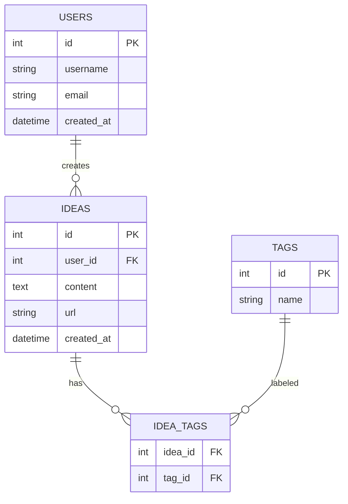
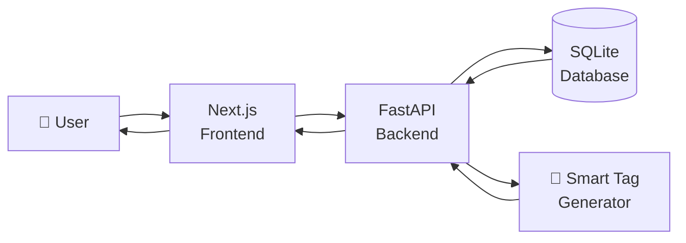

# IDEA VAULT:

## The Correct Model: Build-First, Learn-When-Stuck

Here's how your 6 days actually look:

### 1 — "I want to build an idea vault"
- Open Cursor. Start a project.
- **Stuck:** "How do I save ideas?"
- **Learn:** What a database is, `CREATE TABLE`, `INSERT`, `SELECT`. 30 minutes, not 4 hours.
- **Build:** Create `ideas` table, insert one idea, read it back.
- **Stuck:** "How do I write this in a file?"
- **Learn:** `sql-practice.sql`, how to run it.
- **Build:** Save your queries.
- **Stuck:** "How do I not lose this work?"
- **Learn:** `git init`, `git add`, `git commit`. 15 minutes.
- **Build:** Commit.
- **Done for the day.** You learned SQL, Git, and databases — *by building*.

### 2 — "I want tags on my ideas"
- **Stuck:** "One idea can have many tags, one tag can belong to many ideas. How?"
- **Learn:** Many-to-many relationship, junction table.
- **Build:** `tags` table + `idea_tags` table. Write JOIN queries.
- **Stuck:** "My queries are getting complex."
- **Learn:** `INNER JOIN`, `GROUP BY`. 20 minutes.
- **Build:** Finish the 20 queries.
- **Commit.**
- **Done.** You learned intermediate SQL — *by building*.

###  3 — "I want this to be an actual API"
- **Stuck:** "How do I make an API in Python?"
- **Learn:** FastAPI basics — `@app.get()`, `@app.post()`. 1 hour.
- **Build:** `GET /ideas`, `POST /ideas`.
- **Stuck:** "Python syntax is weird."
- **Learn:** Just the syntax you need — functions, dicts, f-strings.
- **Build:** Finish the endpoints.
- **Commit.**
- **Done.** You learned Python + FastAPI — *by building*.

###  4 — "The smart tag endpoint"
- **Stuck:** "How do I generate tags?"
- **Learn:** String manipulation, or how to call an LLM API. 30 minutes.
- **Build:** `POST /ideas/{id}/generate-tags`.
- **Stuck:** "I want a UI now."
- **Learn:** React basics — components, `useState`. 1 hour.
- **Build:** A basic dashboard.
- **Commit.**
- **Done.**

###  5 — "Make it look good + filter"
- **Stuck:** "How do I filter by tag?"
- **Learn:** React state, conditional rendering. 30 minutes.
- **Build:** Filter component.
- **Stuck:** "CORS error!"
- **Learn:** What CORS is, `CORSMiddleware`. 20 minutes.
- **Build:** Fix it. **Log it in AI_JOURNAL.**
- **Commit.**

###  6 — "Prove it works"
- **Stuck:** "How do I test an API?"
- **Learn:** Postman basics. 1 hour.
- **Build:** 10+ requests.
- **Stuck:** "How do I write test cases?"
- **Learn:** Test case structure, severity vs priority. 30 minutes.
- **Build:** `test-cases.md`, `bug-reports.md`.
- **Commit. Push. Done.**

---

## The Rule: Learn Only When You Have a Specific Problem

**Bad question:** "What should I learn today?"
**Good question:** "What do I want to build today, and what's blocking me?"

The block tells you what to learn. Nothing else.

# Idea Vault — Flowchart( first iteration)

Paste this straight into your `README.md` on GitHub. Everything below is GitHub-ready.

---

## 📐 System Architecture

---

## 🔄 User Flow

---

## 🗄️ Database Schema

---

## ⚡ Simple Linear Overview

---

## How to Use

1. Create `README.md` in your `idea-vault/` repo
2. Paste any/all of the blocks above **including** the triple backticks
3. `git add README.md && git commit -m "Add architecture diagrams" && git push`
4. GitHub renders the diagrams automatically

**Recommended order in README:** System Architecture → User Flow → Database Schema → Simple Overview (or drop the last one if you want it clean).
