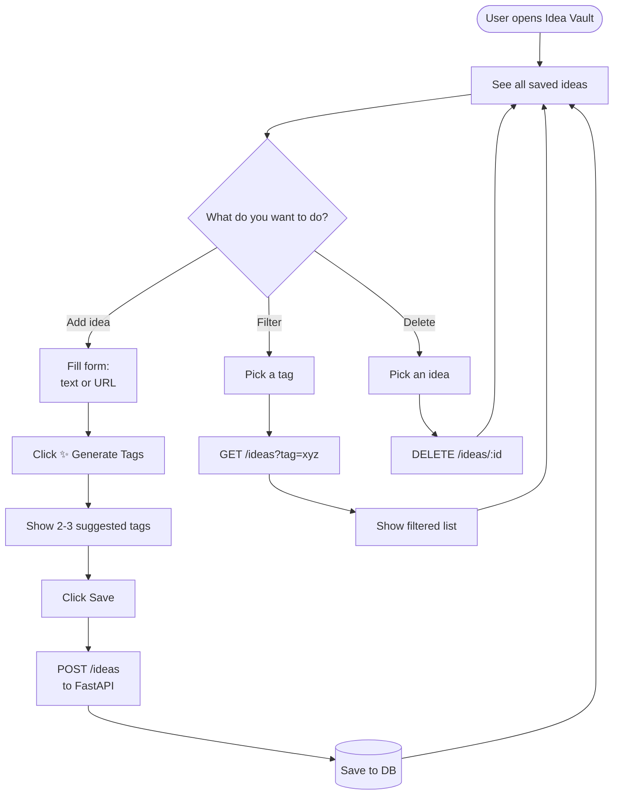
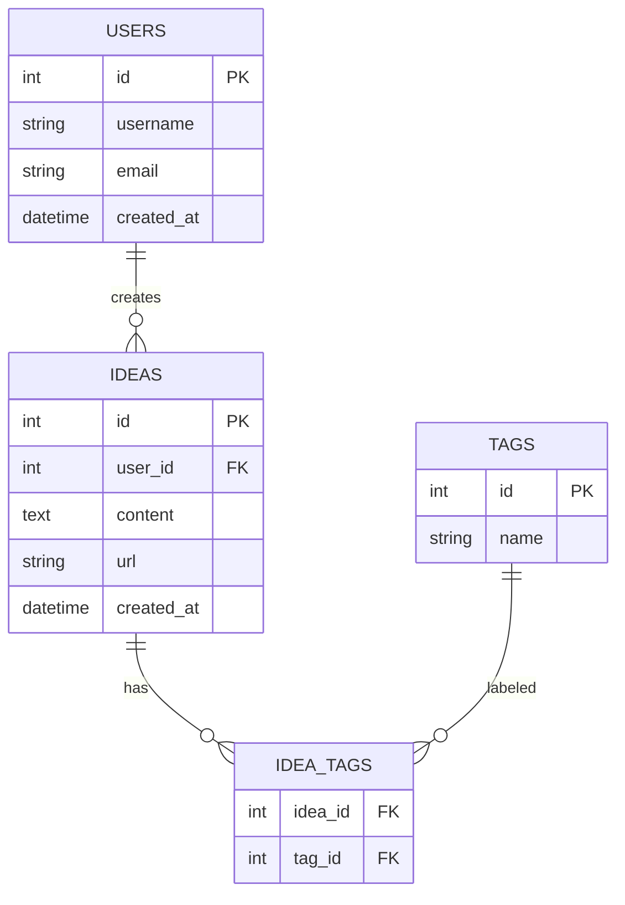
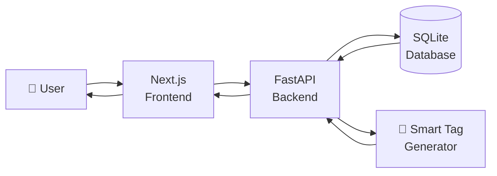
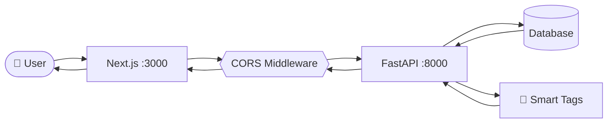

# IDEA VAULT:

## The Correct Model: Build-First, Learn-When-Stuck

Here's how your 6 days actually look:

### 1 — "I want to build an idea vault"
- Open Cursor. Start a project.
- **Stuck:** "How do I save ideas?"
- **Learn:** What a database is, `CREATE TABLE`, `INSERT`, `SELECT`. 30 minutes, not 4 hours.
- **Build:** Create `ideas` table, insert one idea, read it back.
- **Stuck:** "How do I write this in a file?"
- **Learn:** `sql-practice.sql`, how to run it.
- **Build:** Save your queries.
- **Stuck:** "How do I not lose this work?"
- **Learn:** `git init`, `git add`, `git commit`. 15 minutes.
- **Build:** Commit.
- **Done for the day.** You learned SQL, Git, and databases — *by building*.

### 2 — "I want tags on my ideas"
- **Stuck:** "One idea can have many tags, one tag can belong to many ideas. How?"
- **Learn:** Many-to-many relationship, junction table.
- **Build:** `tags` table + `idea_tags` table. Write JOIN queries.
- **Stuck:** "My queries are getting complex."
- **Learn:** `INNER JOIN`, `GROUP BY`. 20 minutes.
- **Build:** Finish the 20 queries.
- **Commit.**
- **Done.** You learned intermediate SQL — *by building*.

###  3 — "I want this to be an actual API"
- **Stuck:** "How do I make an API in Python?"
- **Learn:** FastAPI basics — `@app.get()`, `@app.post()`. 1 hour.
- **Build:** `GET /ideas`, `POST /ideas`.
- **Stuck:** "Python syntax is weird."
- **Learn:** Just the syntax you need — functions, dicts, f-strings.
- **Build:** Finish the endpoints.
- **Commit.**
- **Done.** You learned Python + FastAPI — *by building*.

###  4 — "The smart tag endpoint"
- **Stuck:** "How do I generate tags?"
- **Learn:** String manipulation, or how to call an LLM API. 30 minutes.
- **Build:** `POST /ideas/{id}/generate-tags`.
- **Stuck:** "I want a UI now."
- **Learn:** React basics — components, `useState`. 1 hour.
- **Build:** A basic dashboard.
- **Commit.**
- **Done.**

###  5 — "Make it look good + filter"
- **Stuck:** "How do I filter by tag?"
- **Learn:** React state, conditional rendering. 30 minutes.
- **Build:** Filter component.
- **Stuck:** "CORS error!"
- **Learn:** What CORS is, `CORSMiddleware`. 20 minutes.
- **Build:** Fix it. **Log it in AI_JOURNAL.**
- **Commit.**

###  6 — "Prove it works"
- **Stuck:** "How do I test an API?"
- **Learn:** Postman basics. 1 hour.
- **Build:** 10+ requests.
- **Stuck:** "How do I write test cases?"
- **Learn:** Test case structure, severity vs priority. 30 minutes.
- **Build:** `test-cases.md`, `bug-reports.md`.
- **Commit. Push. Done.**

---

## The Rule: Learn Only When You Have a Specific Problem

**Bad question:** "What should I learn today?"
**Good question:** "What do I want to build today, and what's blocking me?"

The block tells you what to learn. Nothing else.

# Idea Vault — Flowchart( first iteration)


---

## 📐 System Architecture


# Breaking Down Every Term (Plain English)

Let me explain each one like you've never seen it before.

---

## 1. "Rendered UI"

**UI** = User Interface = **what the user sees on screen**.

**Rendered** = drawn/painted on screen by the browser.

**"Rendered UI"** = the final visual output the user looks at — buttons, text, cards, forms.

### Simple Example

You write this in React:
```jsx
<h1>My Idea Vault</h1>
<p>3 ideas saved</p>
```

The browser **renders** it into:
> **My Idea Vault**
> 3 ideas saved

**Before rendering:** raw code (HTML/JSX)
**After rendering:** pixels on screen that human eyes can see

### Analogy
- **Raw HTML/JSX** = architect's blueprint
- **Rendered UI** = the actual house you walk into

The flowchart arrow `FE -->|Rendered UI| User` means: **"The frontend sends the finished visual to the user's screen."**

---

## 2. `Frontend :3000` (the `:3000` part)

The `:3000` is a **port number**.

### What's a Port?

Think of your computer like a **big apartment building**.
- The **IP address** (`localhost` or `192.168.1.5`) = the building's street address
- The **port number** (`:3000`, `:8000`) = the **apartment number**

Multiple apps run on the same computer, each in a different "apartment."

### Why `:3000` for Frontend?

Next.js (and most React dev servers) **default to port 3000**. So when you run:
```bash
npm run dev
```

You see:
```
▲ Next.js ready on http://localhost:3000
```

You open that URL in your browser → you see your frontend.

**`localhost:3000`** = "this computer, apartment 3000 = Next.js frontend"

You could change it, but `:3000` is the convention. Just leave it.

---

## 3. `Backend :8000` (the `:8000` part)

Same idea — a port number for the backend.

### Why `:8000` for Backend?

FastAPI + uvicorn (the server that runs FastAPI) **defaults to port 8000**. When you run:
```bash
uvicorn main:app --reload
```

You see:
```
Uvicorn running on http://127.0.0.1:8000
```

You open that URL → you see FastAPI's auto-generated docs at `/docs`.

**`localhost:8000`** = "this computer, apartment 8000 = FastAPI backend"

### Why Different Ports?

Because **both apps run at the same time on your machine.**

- `localhost:3000` → Next.js (the UI)
- `localhost:8000` → FastAPI (the data/logic)

Your browser talks to `:3000` to show the UI. The UI talks to `:8000` to get data.

### Analogy
- `:3000` = the **showroom** (where customers walk in)
- `:8000` = the **warehouse** (where the products are stored)

The showroom (frontend) calls the warehouse (backend) to fetch products (data).

---

## 4. CORS Middleware

Two words to unpack: **CORS** and **Middleware**.

### What is CORS?

**CORS = Cross-Origin Resource Sharing**

It's a **browser security rule**: "Should this website be allowed to talk to that other website?"

### The "Origin" Concept

An **origin** = `protocol + domain + port`

| URL | Origin |
|-----|--------|
| `http://localhost:3000` | `http://localhost:3000` |
| `http://localhost:8000` | `http://localhost:8000` |
| `https://google.com` | `https://google.com` |

Two URLs have the **same origin** only if protocol, domain, AND port all match.

### The Problem

- Your frontend runs at `localhost:3000`
- Your backend runs at `localhost:8000`
- **Different ports → different origins**

When the frontend tries to fetch data from the backend, the **browser blocks it** by default:

> ❌ **CORS error: Access to fetch at 'http://localhost:8000/ideas' from origin 'http://localhost:3000' has been blocked by CORS policy.**

This is a **browser** rule, not a server rule. It exists so that `evil-website.com` can't silently call `your-bank.com/api/transfer-money` using your logged-in cookies.

### What is Middleware?

**Middleware** = code that runs **between** the request and your actual endpoint. It can inspect, modify, or block requests.

```
Request → [Middleware 1] → [Middleware 2] → Your endpoint → Response
```

### CORS Middleware

FastAPI has a built-in middleware that **adds special headers** to every response saying: *"It's OK for localhost:3000 to call me."*

```python
from fastapi.middleware.cors import CORSMiddleware

app.add_middleware(
    CORSMiddleware,
    allow_origins=["http://localhost:3000"],  # who can call me
    allow_methods=["*"],                       # GET, POST, DELETE, etc.
    allow_headers=["*"],                       # which headers allowed
)
```

Once added, the browser sees those headers and says: *"OK, this is allowed."* CORS error disappears.

### Why This Matters for Your Project

**You WILL hit this error.** It's practically guaranteed when connecting Next.js to FastAPI. It's the #1 beginner roadblock.

The document mentions it specifically:
> *"AI hallucinations or errors (e.g., CORS blunders)"*

**Log it in `AI_JOURNAL.md`.** It's proof you debugged a real-world problem.

---

## 5. Mock NLP

Two words: **Mock** and **NLP**.

### What is NLP?

**NLP = Natural Language Processing**

It's the field of AI that deals with **human language**: text, speech.

Examples:
- ChatGPT understanding your question → NLP
- Google Translate → NLP
- Siri understanding "set a timer" → NLP
- Gmail detecting spam → NLP

**For your project:** given a sentence like *"Build a habit tracker app"*, NLP would **figure out the topic** and suggest tags like `#productivity`, `#health`.

### What is "Mock"?

**Mock** = fake, simulated, pretend.

A **mock NLP** = **fake NLP.** It *looks* like it understands language, but it's just simple rules.

### Real NLP vs Mock NLP

**Real NLP (using OpenAI API):**
```python
response = openai.chat.completions.create(
    model="gpt-4o-mini",
    messages=[{"role": "user", "content": "Suggest 3 tags for: Build a habit tracker app"}]
)
# → "health, productivity, habit-formation"  ← AI actually understood
```

**Mock NLP (simple keyword matching):**
```python
def generate_tags(text):
    tags = []
    if "habit" in text.lower():
        tags.append("health")
    if "app" in text.lower():
        tags.append("side-project")
    if "read" in text.lower() or "article" in text.lower():
        tags.append("reading")
    return tags[:3]

# "Build a habit tracker app" → ["health", "side-project"]
```

The mock version isn't smart. It just checks for keywords. But it **behaves like** NLP — you feed it text, it returns tags.

### Why Use Mock NLP?

| Reason | Explanation |
|--------|-------------|
| **Free** | No API key, no billing |
| **Fast** | No network call, instant response |
| **Reliable** | Doesn't fail when internet is down |
| **Simple** | 10 lines of Python |
| **Good enough** | For a learning project, this satisfies the requirement |

### The Document Says:

> *"auto-generates 2-3 tags for new ideas (via mock NLP or an LLM API)"*

So you have **two choices**:
1. **Mock NLP** → free, simple, no API key needed ✅ **recommended**
2. **Real LLM API** → cooler, smarter, but needs OpenAI/Anthropic API key + costs money

**Pick mock NLP for the project.** It's fully sufficient and hits the requirement.

---

## Summary Table

| Term | Plain English | Why It Matters |
|------|---------------|----------------|
| **Rendered UI** | What the user sees on screen after React draws it | The final output of your frontend |
| **`:3000`** | Port number = "apartment 3000" where Next.js lives | Convention for React/Next.js |
| **`:8000`** | Port number = "apartment 8000" where FastAPI lives | Convention for FastAPI |
| **CORS Middleware** | Security rule + code that allows cross-origin requests | You WILL hit this. Log it. |
| **Mock NLP** | Fake AI that uses keyword rules to generate tags | Free, simple way to hit the "smart" requirement |

---

## The Full Picture (One Sentence Each)

1. **Frontend** at `:3000` builds the **rendered UI** the user sees
2. **Backend** at `:8000` serves data via API
3. **CORS middleware** lets the frontend (`:3000`) talk to the backend (`:8000`)
4. **Mock NLP** generates fake-smart tags when you save an idea

That's your entire app in 4 lines. Everything else is detail.

---

Want me to show you the **actual code** for a working CORS setup + mock NLP function that you can paste into your FastAPI app?

---

## 🔄 User Flow



---

## 🗄️ Database Schema



---

## ⚡ Simple Linear Overview



---


# START

# Let's Start. Right Now. Day 1.

Forget the whole 6-day plan for a second. **We're only doing today.** Here's exactly what to do, step by step, in order.

---

##  5-Minute Setup Check


- [ ] Do you have **Python** installed? (`python --version` in terminal)
- [ ] Do you have **Node.js** installed? (`node --version`)
- [ ] Do you have **Git** installed? (`git --version`)
- [ ] Do you have **Cursor** or **Windsurf** installed? (AI editor)
- [ ] Do you have a **GitHub account**?

If any is missing, install it first. Reply and I'll walk you through whichever is missing.

nstall Cursor (Recommended, Simplest)
Cursor is free to download and install, just like a regular software.

Open cursor.com/download

Select the installer for your system (Windows .exe, Mac .dmg, Linux .AppImage or package)

After installation, open it and sign up for a free account to use it

If all ✅ → proceed below.

---


## Step 1: Create the Project Folder (2 min)

Open your terminal. Run these **exactly**:

```bash
mkdir idea-vault
cd idea-vault
```

You're now inside an empty folder called `idea-vault`.

---

## Step 2: Initialize Git (1 min)

```bash
git init
```

You'll see: `Initialized empty Git repository in .../idea-vault/.git/`

That's it. Git is now tracking this folder.

---

## Step 3: Create Your First 3 Files (10 min)

You need exactly **3 files** today:

### File 1: `README.md`

Create the file and paste this:

```markdown
# 💡 Idea Vault

A personal app to save ideas and links, auto-tag them, and filter by tag.

## Tech Stack
- **Backend:** FastAPI (Python)
- **Frontend:** Next.js (React)
- **Database:** SQLite (dev) → PostgreSQL (prod)
- **AI:** Mock NLP for tag generation

## Status
🚧 Day 1 — Project setup

## Architecture



## Deliverables Checklist
- [ ] Day 1: Setup + notes
- [ ] Day 2: Database schema
- [ ] Day 3: Python + FastAPI basics
- [ ] Day 4: Backend complete
- [ ] Day 5: Frontend complete
- [ ] Day 6: Tests + docs
```

# NOTES

## What I Set Up Today
- Created `idea-vault` repo
- Initialized Git
- Wrote README + architecture diagram

## What I Learned
- Git basics: `git init`, `git add`, `git commit`
- How the web works: browser (client) → API (server) → database
- HTTP methods: GET (read), POST (create), DELETE (remove)

## What I'm Building
A personal "Idea Vault" — save ideas/URLs, auto-tag them, filter by tag.

## What Confused Me (so far)
1. What exactly does CORS mean?
2. How do frontend and backend talk to each other?
3. What is a port number?
```

### File 3: `.gitignore`

This is **critical** — prevents committing junk. Create `.gitignore`:

```
# Python
__pycache__/
*.pyc
venv/
.env

# Node
node_modules/
.next/
out/

# Databases
*.db
*.sqlite

# OS
.DS_Store
Thumbs.db

# IDE
.vscode/
.idea/
```

**Why this matters:** Without `.gitignore`, you'll commit `node_modules` (500MB of junk), API keys (security disaster), and cache files. **Do this now, not later.**

# USE OF .gitignore
# `.gitignore` — Explained Like You're 10

## The One-Line Answer

`.gitignore` is a **list of files Git should pretend don't exist.**

That's it. You write names in it, and Git ignores those files forever — never commits them, never pushes them, never asks about them.

---

## Why Would You Want That?

Because **not everything in your folder should go to GitHub.**

Some files are:

| Type | Example | Why ignore it |
|------|---------|---------------|
| **Huge** | `node_modules/` (500MB of libraries) | Would make your repo bloated. Anyone can reinstall them with `npm install`. |
| **Secret** | `.env` (API keys, passwords) | If you push it, **anyone on the internet can steal your keys**. 💀 |
| **Auto-generated** | `__pycache__/`, `.next/` | Created automatically every time you run the app. Useless to commit. |
| **Personal** | `.vscode/`, `.DS_Store` | Just your editor settings. Not part of the app. |
| **Local database** | `vault.db` | Your test data. Not the app itself. |

**Your actual code** = `README.md`, `main.py`, `package.json`, `notes/` → **these should go to GitHub.**

**Junk** = `node_modules/`, `.env`, `__pycache__/` → **these should NOT.**

`.gitignore` is how you tell Git the difference.

---

## A Real-Life Analogy

Imagine you're moving houses and hiring movers.

- **The movers** = Git (they carry stuff to your new house)
- **Your house** = your project folder
- **Your new house** = GitHub

You don't want the movers to carry:
- 🗑️ The trash (temp files)
- 🔑 Your house keys (secrets)
- 🧱 The walls themselves (auto-generated stuff)

You only want them to carry:
- ✅ Your furniture (actual code)
- ✅ Your photos (notes, docs)

`.gitignore` is **the sticky note you hand to the movers**:

> "Don't touch anything in the trash, don't touch the keys, don't touch the walls. Everything else — go."

---

## Without `.gitignore` — The Disaster

You do `git add .` (add everything). Without `.gitignore`:

1. **`node_modules/`** (500MB, 30,000 files) gets committed. Your push takes 20 minutes. GitHub yells at you.
2. **`.env`** gets committed. Your `OPENAI_API_KEY=sk-abc123...` is now public. Someone finds it in 5 minutes and racks up $10,000 on your card.
3. **`__pycache__/`** gets committed. Every time you run Python, cache files change. Now every commit is 200 files of noise.
4. **`vault.db`** (your test data) gets committed. Every time you add an idea, the DB changes. Now your repo fills with binary diffs.

**All of these are painful to fix later.** You have to rewrite git history (scary). Easier to set it up **before** the first commit — which is exactly where you are now.

---

## How to Read a `.gitignore` File

```
# Python
__pycache__/
*.pyc
venv/
.env
```

Line by line:

| Line | Meaning |
|------|---------|
| `# Python` | Comment. Git ignores the line. Just for humans. |
| `__pycache__/` | Ignore any folder named `__pycache__` (the `/` means folder) |
| `*.pyc` | Ignore any file ending in `.pyc` (the `*` means anything) |
| `venv/` | Ignore the `venv` folder (your Python virtual environment) |
| `.env` | Ignore the file named exactly `.env` (your secrets) |

### Syntax Cheat Sheet

| Pattern | Means |
|---------|-------|
| `node_modules/` | Any folder named `node_modules` |
| `*.log` | Any file ending in `.log` |
| `vault.db` | The exact file `vault.db` |
| `**/temp` | `temp` folder anywhere in the tree |
| `!important.txt` | **Don't** ignore `important.txt` (exception) |

You don't need to memorize this. **Copy a template. Add to it as needed.**

---

## Where Does `.gitignore` Live?

**In the root of your repo** — same folder as `README.md` and `.git`.

```
idea-vault/
├── .git/
├── .gitignore        ← HERE
├── README.md
└── notes/
```

**One `.gitignore` per repo is enough.** It covers the entire project.

---

## What Happens When You Run `git add .` with `.gitignore`?

```
Your folder:
├── README.md           → ✅ added
├── main.py             → ✅ added
├── .env                → ❌ ignored
├── node_modules/       → ❌ ignored
├── __pycache__/        → ❌ ignored
└── vault.db            → ❌ ignored
```

Only the ✅ files get committed. The ❌ ones are **invisible** to git. `git status` won't even show them as "untracked."

---

## What If You Already Committed Something You Shouldn't Have?

Common question. Here's the fix (don't do this now, just know it exists):

```bash
# Stop tracking a file (keeps it on disk, removes from git)
git rm --cached .env

# Then commit
git commit -m "Remove .env from tracking"
```

But this **doesn't remove it from history** — the secret is still in past commits. To fully purge, you'd use `git filter-repo` (advanced). **Just set up `.gitignore` on Day 1** and you never have this problem.

---

## The Version You Should Paste (Exactly)

```gitignore
# Python
__pycache__/
*.pyc
*.pyo
venv/
.venv/
.env

# Node
node_modules/
.next/
out/
dist/
build/
npm-debug.log*

# Databases
*.db
*.sqlite
*.sqlite3

# OS
.DS_Store
Thumbs.db

# IDE
.vscode/
.idea/
*.swp

# Logs
*.log
```

**Save this as `.gitignore` in `idea-vault/`.** Done. You're protected forever.

---

## TL;DR — The 30-Second Version

- `.gitignore` = a **list of files git should never touch**
- It lives **in the root folder**, named exactly `.gitignore`
- It prevents committing **secrets, huge files, junk, and OS/editor files**
- Without it → you leak keys, bloat the repo, get messy history
- With it → clean repo, no leaks, no pain
- **Set it up BEFORE your first commit** 
```

Git should show `.gitignore` as a file to commit, and **NOT** show any junk. Paste the `git status` output here and we'll commit Day 1.
---

## Step 4: Your First Commit (2 min)

```bash
git add .
git commit -m "Day 1: Initial project setup with README and notes"
```

Check it worked:

```bash
git log
```

You should see your commit.

**🎉 You just made your first commit. This is Deliverable #1 (part 1 of 3) done.**

---

## Step 5: Push to GitHub (5 min)

### 5a. Create the repo on GitHub

1. Go to [github.com/new](https://github.com/new)
2. **Repository name:** `idea-vault`
3. **Visibility:** Public (recruiters can see it) or Private (only you)
4. **DO NOT** check "Add a README" (you already have one)
5. Click **Create repository**

### 5b. Connect local → GitHub

GitHub shows you commands. They look like:

```bash
git remote add origin https://github.com/YOUR_USERNAME/idea-vault.git
git branch -M main
git push -u origin main
```

Copy-paste them one by one. Replace `YOUR_USERNAME` with your actual GitHub username.

### 5c. Verify

Refresh the GitHub page. You should see:
- `README.md` (with a rendered flowchart!)
- `notes/day1.md`
- `.gitignore`

**🎉 Your project is now live on GitHub.** Send yourself the link.

---

## Step 6: Read One Thing (10 min, no videos)

You said no videos — good. **Read** this one short article:

👉 **"How the Web Works" — MDN** → [https://developer.mozilla.org/en-US/docs/Learn/Getting_started_with_the_web/How_the_Web_works](https://developer.mozilla.org/en-US/docs/Learn/Getting_started_with_the_web/How_the_Web_works)

Just read it. Don't take notes. Don't watch anything. It's 5 minutes.

**Why?** Because tomorrow you'll build an API, and you need a mental model of client → server → response. That's the only concept you need today.

---

## What You Have Now

By end of Day 1, you have:

✅ A Git repo called `idea-vault`
✅ A README with an architecture diagram
✅ Day 1 notes committed
✅ A `.gitignore` protecting you from future mistakes
✅ Everything pushed to GitHub
✅ 1 of 3 required commits done
✅ A clear mental model of what you're building


# do we actually write sql queries?


totally understand why you are confused. Let's take a step back. You asked the best question of the entire project:

"In reality, who will write the query and who will fetch it?"

Here is the exact answer: The Backend (FastAPI) does both.

Let me explain how it works in reality vs. how it works in practice.
1. The Reality: Nobody types SQL in the final app.
In modern software development, we don't actually write SELECT * FROM ideas in the final app. We use tools like SQLAlchemy (an ORM - Object Relational Mapper).

When the frontend (Next.js) says "I need all the ideas," the Backend (FastAPI) receives that request. FastAPI doesn't run raw SQL; it runs a Python command like db.query(Idea).all(). SQLAlchemy takes that Python command and automatically translates it into SQL behind the scenes, sends it to the database, fetches the data, and sends it back to the frontend.

2. The Practice: Why did we write sql-practice.sql?
Even though SQLAlchemy writes the SQL automatically, you still have to know SQL. Why?

Because when the app is slow, you need to look at the SQL and see why it's slow.

Because when data gets messed up, you need to know how to go into the database and fix it manually.


# how sqlalchemy works


# content shld not be null , wht can we do to solve this problem 
The 3 Layers of Defense (The Whole Picture)
When you build the final app, you actually have three layers of defense protecting your data:

Frontend (Next.js): The user can't click "Submit" if the text box is empty. (User experience)

Backend (Pydantic): The API checks the request. If someone bypasses the frontend and sends an empty request via Postman, Pydantic returns a 422 Error. (API security)

Database (SQLAlchemy & SQL): If a bug in the code tries to save empty data, SQLAlchemy blocks it, and the SQL NOT NULL is the final safety net. (Data integrity)


Awesome! Let's officially start **Day 3: The Python Backend (FastAPI)**.

Today, you stop writing raw SQL and start writing the actual app. This is where the magic happens: we will write Python code that connects to a database, creates the tables automatically, and starts an API server that the frontend can talk to.

Follow these steps exactly.

---

### Step 1: Set Up the Backend Folder

Open your terminal. Make sure you are inside your `idea-vault` folder.

Run these commands **one by one**:

```bash
# 1. Create a folder for the backend
mkdir backend
cd backend

# 2. Create a Python virtual environment (this keeps your project clean)
python -m venv venv

# 3. Activate the virtual environment
# (Windows Command Prompt):
venv\Scripts\activate
# (Windows Git Bash or Mac/Linux):
source venv/bin/activate
```
*You should now see `(venv)` at the start of your terminal line. This means you are inside the virtual environment.*

```bash
# 4. Install FastAPI and SQLAlchemy
pip install fastapi uvicorn sqlalchemy
```

---

### Step 2: Create the Database Setup (`database.py`)

Inside the `backend` folder, create a file named **`database.py`**. 

Copy and paste this code into it. This file is just to set up the "waiter" (SQLAlchemy) so it knows where the database lives.

```python
from sqlalchemy import create_engine
from sqlalchemy.orm import declarative_base, sessionmaker

# This creates a file called vault.db in your backend folder
SQLALCHEMY_DATABASE_URL = "sqlite:///./vault.db"

# The engine is the actual connection to the database
engine = create_engine(
    SQLALCHEMY_DATABASE_URL, connect_args={"check_same_thread": False}
)

# SessionLocal is what we use to talk to the database
SessionLocal = sessionmaker(autocommit=False, autoflush=False, bind=engine)

# Base is what we use to define our tables
Base = declarative_base()
```

---

### Step 3: Create the Main App (`main.py`)

Inside the `backend` folder, create a second file named **`main.py`**.

Copy and paste this code. **Read the comments** to see how this matches the flowchart I showed you earlier.

```python
from fastapi import FastAPI
from pydantic import BaseModel
from sqlalchemy import Column, Integer, String
from database import SessionLocal, engine, Base

# --- 1. DEFINE THE DATABASE TABLE ---
# This tells SQLAlchemy to create the 'ideas' table automatically.
class Idea(Base):
    __tablename__ = "ideas"
    
    id = Column(Integer, primary_key=True, index=True)
    content = Column(String, nullable=False) # This is the NOT NULL rule!
    url = Column(String, nullable=True)

# This line actually creates the table in vault.db if it doesn't exist
Base.metadata.create_all(bind=engine)


# --- 2. DEFINE THE PYDANTIC SCHEMA ---
# This is the "bouncer" that checks the data coming from the frontend.
class IdeaCreate(BaseModel):
    content: str
    url: str | None = None


# --- 3. CREATE THE API ---
app = FastAPI()

# Endpoint A: GET all ideas
@app.get("/ideas")
def get_ideas():
    db = SessionLocal()
    ideas = db.query(Idea).all()  # <--- The SQLAlchemy magic!
    db.close()
    return ideas

# Endpoint B: POST a new idea
@app.post("/ideas")
def create_idea(idea: IdeaCreate):
    db = SessionLocal()
    # Create a new Idea object using the data from Pydantic
    new_idea = Idea(content=idea.content, url=idea.url)
    
    db.add(new_idea)       # Add it to the session
    db.commit()            # Save it to the database
    db.refresh(new_idea)   # Get the new ID generated by the database
    db.close()
    
    return new_idea
```

---

### Step 4: Run the Server!

In your terminal (make sure you are inside the `backend` folder and `(venv)` is active), run:

```bash
uvicorn main:app --reload
```

You will see output like this:
```
INFO:     Uvicorn running on http://127.0.0.1:8000 (Press CTRL+C to quit)
INFO:     Started reloader process...
```

**Now, open your web browser and go to:** `http://127.0.0.1:8000/docs`

---

### Step 5: Test Your API (The Magic Moment)

You should see a page called "FastAPI - Swagger UI". This is a visual interface for your API.

1. Click on **POST /ideas**.
2. Click the **"Try it out"** button on the right.
3. In the Request body box, change the JSON to:
   ```json
   {
     "content": "My first backend idea!"
   }
   ```
4. Click the big blue **Execute** button.
5. Scroll down to the "Server response". You should see a **200 OK** code and the idea returned with an `id` of `1`.

**Now let's prove it saved:**
1. Scroll up and click on **GET /ideas**.
2. Click **"Try it out"**.
3. Click **Execute**.
4. Look at the response body. You will see your idea saved in the database!

---

### Step 6: Commit to GitHub

Stop the server by pressing `Ctrl+C` in your terminal.

Go back to the root of your project (`cd ..`). We need to tell Git to ignore the `venv` folder and the database file (we don't want to push those to GitHub).

Open your `.gitignore` file and add these two lines at the bottom:
```text
backend/venv/
backend/vault.db
```

Now, save and commit:

```bash
git add .
git commit -m "Day 3: Setup FastAPI backend and connected database"
git push
```

---


# 🚀 Day 4: The Smart Feature & AI Journal

Welcome to Day 4! Today, your app gets a brain. 

Right now, when you add an idea, you have to manually think of tags. Today, we build the **"Smart Tag Generator"** endpoint. When the frontend sends an idea like *"Build a habit tracker app"*, the backend will analyze it and return tags like `#health` and `#productivity`. 

We will also set up your **`AI_JOURNAL.md`**, which is a primary deliverable.

---

### Step 1: The "Mock NLP" Logic

Since we don't want to pay for OpenAI API keys right now, we will use **Mock NLP** (keyword matching). It's simple, free, and fulfills the assignment requirement.

1. Open your `main.py` file (inside the `backend` folder).
2. Add this new block of code **at the very bottom** of the file:

```python
# --- 4. THE SMART TAG GENERATOR (Mock NLP) ---
class TagRequest(BaseModel):
    text: str

@app.post("/generate-tags")
def generate_tags(request: TagRequest):
    text = request.text.lower()
    tags = []
    
    # Simple keyword matching logic
    if "app" in text or "build" in text:
        tags.append("side-project")
    if "habit" in text or "health" in text or "workout" in text:
        tags.append("health")
    if "react" in text or "python" in text or "code" in text or "api" in text:
        tags.append("coding")
    if "read" in text or "article" in text or "book" in text:
        tags.append("reading")
    if "ai" in text or "student" in text or "startup" in text:
        tags.append("business")
        
    # If no keywords matched, give a default tag
    if not tags:
        tags.append("random-thought")
        
    # Return the top 3 tags
    return {"original_text": request.text, "generated_tags": tags[:3]}
```

### Step 2: Test the Magic
1. In your terminal, make sure you are in the `backend` folder, `(venv)` is active, and the server is running (`uvicorn main:app --reload`).
2. Go to `http://127.0.0.1:8000/docs` and refresh.
3. You will see a new endpoint: **POST /generate-tags**.
4. Click **Try it out**.
5. Change the request body to:
   ```json
   {
     "text": "I want to build a habit tracker app for students using AI"
   }
   ```
6. Click **Execute**.
7. Look at the Response body! It should return:
   ```json
   {
     "original_text": "I want to build a habit tracker app for students using AI",
     "generated_tags": ["side-project", "health", "business"]
   }
   ```

*(Boom! Your backend now has a smart feature.)*

---

### Step 3: Create your `AI_JOURNAL.md`

The assignment document says this is the **Primary Focus**. It wants to see how you use AI (like ChatGPT, Cursor, or me) to write code, the mistakes the AI made, and how you fixed them.

1. Go to the root of your `idea-vault` folder.
2. Create a new file called **`AI_JOURNAL.md`**.
3. Paste this template inside (and fill it out with your actual experience):

```markdown
# AI Engineering Journal

## Tools Used
- ChatGPT / Claude (for learning concepts and debugging)
- Notepad/VS Code (for writing code)

## Prompt & Debugging Log

### Day 1 & 2: SQL and Database Design
**Prompt:** "Give me a SQLite schema for an idea vault app with users, ideas, and tags."
**Result:** The AI gave me the right tables, but it forgot to add the `idea_tags` junction table at first. I had to ask it to fix the Many-to-Many relationship.
**Lesson:** AI is good at boilerplate, but you must review the database relationships.

### Day 3: FastAPI Setup (The CORS / Port Error)
**Error Encountered:** I tried running my FastAPI server, but the browser kept showing my old project's endpoints (`/get-student`). 
**Fix:** I realized I had another `uvicorn` server running in the background on Port 8000. I used `Ctrl+C` to kill all servers, activated my `(venv)`, and restarted the server in the correct folder.
**Lesson:** Always make sure your virtual environment is active and Port 8000 is free.

### Day 4: Smart Tags (Mock NLP)
**Prompt:** "How do I write a mock NLP function in Python to generate tags based on keywords?"
**Result:** The AI gave me a great `if/else` structure using string matching. I added `text.lower()` to ensure it catches capitalized words.
**Lesson:** Mock NLP is just clever keyword matching—no actual machine learning required!

## AI Hallucinations to Watch Out For
- AI often forgets to tell you to install dependencies (`pip install fastapi`).
- AI sometimes uses PostgreSQL syntax when you asked for SQLite. 
```

---

### Step 4: Commit Day 4

You just added a smart feature and documented your AI process.

1. Go to your terminal, ensure you are in the root `idea-vault` folder.
2. Run:
   ```bash
   git add .
   git commit -m "Day 4: Added smart tag generator endpoint and AI Journal"
   git push
   ```

---


Here is the simplest way to understand the difference between JavaScript, TypeScript, and Next.js. 

Think of building a website like **building a house**.

---

### 1. JavaScript (JS) = The Bricks and Wood
JavaScript is the raw building material. It is the programming language that makes websites interactive (buttons clicking, menus opening). 

*   **The Problem:** JavaScript is very forgiving. If you make a typo, it won't tell you until the exact moment a user clicks the button and the website crashes. 

### 2. TypeScript (TS) = The Blueprint Inspector
TypeScript is **NOT** a new language. It is just JavaScript with a strict boss attached. 
Before you build the house, the inspector looks at your blueprints and says, *"Hey, you said this door needs a number, but you wrote a word. This will break later. Fix it now."*

*   **The Benefit:** It catches your mistakes *while you are typing*, before you even run the code. It saves you hours of debugging.
*   **How it works:** You write TypeScript, and a computer program automatically translates it into regular JavaScript so the browser can read it.

### 3. Next.js = The Pre-Fab House Kit
Next.js is a **framework**. It is built on top of React (which is built on JavaScript). 
Instead of buying raw wood and nailing every board yourself, Next.js gives you pre-built walls, plumbing, and electrical wiring. 

*   **The Benefit:** It handles the boring stuff (routing between pages, making the site load fast, optimizing images). You just focus on building your app.
*   *(Note: You can write Next.js code in JavaScript OR TypeScript. Next.js doesn't care).*

---

### Summary Table

| Name | What is it? | Analogy |
| :--- | :--- | :--- |
| **JavaScript (JS)** | The core programming language. | Raw wood and bricks. |
| **TypeScript (TS)** | JavaScript + a strict spell-checker. | The blueprint inspector. |
| **Next.js** | A tool that makes building React apps easy. | The pre-fab house kit. |

*(And just to complete the picture: **React** is the library that lets you build UI components like buttons and forms. **Next.js** is the framework that makes React work really well).*

---

# 🚀 Day 5: The Next.js Frontend (From Scratch)


---

### Step 1: Setup the Frontend Folder
Open a terminal and make sure you are in the root of your project (`C:\Users\samh7\idea-vault`).

Run this command to create the Next.js app:
```bash
npx create-next-app@latest frontend
```

Answer the prompts exactly like this (use arrow keys and press Enter):
*   Would you like to use **TypeScript**? -> **Yes**
*   Would you like to use **ESLint**? -> **Yes**
*   Would you like to use **Tailwind CSS**? -> **Yes**
*   Would you like to use **`src/` directory**? -> **No**
*   Would you like to use **App Router**? -> **Yes**
*   Would you like to customize the default import alias? -> **No**

*(This will take 1-2 minutes to download and install).*

### Step 2: Start the Frontend Server
Once it finishes, go into the new folder and start the development server:
```bash
cd frontend
npm run dev
```

Open your browser and go to `http://localhost:3000`. You should see the Next.js default welcome page.
*(Leave this terminal running. Your frontend is now live on port 3000, and your backend is on port 8000).*

---

### Step 3: Write the Dashboard UI
Open the `frontend` folder in your code editor (VS Code or Cursor).
Open the file `app/page.tsx` and **delete everything inside it**.

Copy and paste this exact code into `app/page.tsx`. Read the green comments to understand what the code is doing.

```tsx
"use client"; // This tells Next.js this file runs in the browser

import { useState, useEffect } from "react";

// 1. Define the TypeScript interface (What an Idea looks like)
interface Idea {
  id: number;
  content: string;
  url: string | null;
}

export default function Home() {
  // 2. Set up State (Variables that update the screen)
  const [ideas, setIdeas] = useState<Idea[]>([]); // Array of ideas
  const [content, setContent] = useState("");     // The text input
  const [url, setUrl] = useState("");             // The URL input
  const [isLoading, setIsLoading] = useState(false);

  // 3. Fetch ideas from FastAPI
  const fetchIdeas = async () => {
    try {
      const response = await fetch("http://127.0.0.1:8000/ideas");
      const data = await response.json();
      setIdeas(data);
    } catch (error) {
      console.error("Failed to fetch ideas:", error);
    }
  };

  // Run fetchIdeas once when the page loads
  useEffect(() => {
    fetchIdeas();
  }, []);

  // 4. Handle the form submission (Add a new idea)
  const handleSubmit = async (e: React.FormEvent) => {
    e.preventDefault(); // Stop page refresh
    if (!content) return; // Don't submit empty ideas

    setIsLoading(true);

    try {
      // Send data to FastAPI
      await fetch("http://127.0.0.1:8000/ideas", {
        method: "POST",
        headers: {
          "Content-Type": "application/json",
        },
        body: JSON.stringify({ content, url: url || null }),
      });

      // Clear the form
      setContent("");
      setUrl("");
      
      // Refresh the list
      await fetchIdeas();
    } catch (error) {
      console.error("Failed to add idea:", error);
    } finally {
      setIsLoading(false);
    }
  };

  // 5. The UI (HTML + Tailwind CSS)
  return (
    <main className="min-h-screen bg-gray-900 text-white p-8">
      <div className="max-w-3xl mx-auto">
        <h1 className="text-4xl font-bold text-blue-400 mb-8">💡 Idea Vault</h1>

        {/* ADD IDEA FORM */}
        <form onSubmit={handleSubmit} className="bg-gray-800 p-6 rounded-lg shadow-lg mb-8">
          <h2 className="text-xl font-semibold mb-4">Add a New Idea</h2>
          
          <div className="mb-4">
            <label className="block text-sm text-gray-400 mb-1">Idea Content</label>
            <textarea
              className="w-full bg-gray-700 text-white p-3 rounded focus:outline-none focus:ring-2 focus:ring-blue-500"
              rows={3}
              placeholder="What's on your mind?"
              value={content}
              onChange={(e) => setContent(e.target.value)}
              required
            />
          </div>

          <div className="mb-4">
            <label className="block text-sm text-gray-400 mb-1">URL (Optional)</label>
            <input
              type="url"
              className="w-full bg-gray-700 text-white p-3 rounded focus:outline-none focus:ring-2 focus:ring-blue-500"
              placeholder="https://example.com"
              value={url}
              onChange={(e) => setUrl(e.target.value)}
            />
          </div>

          <button
            type="submit"
            disabled={isLoading}
            className="bg-blue-600 hover:bg-blue-700 text-white font-bold py-2 px-6 rounded transition duration-200"
          >
            {isLoading ? "Saving..." : "Save Idea"}
          </button>
        </form>

        {/* IDEAS LIST */}
        <div>
          <h2 className="text-2xl font-semibold mb-4">Your Ideas ({ideas.length})</h2>
          
          {ideas.length === 0 ? (
            <p className="text-gray-400">No ideas yet. Add one above!</p>
          ) : (
            <div className="space-y-4">
              {ideas.map((idea) => (
                <div key={idea.id} className="bg-gray-800 p-5 rounded-lg border border-gray-700">
                  <p className="text-lg mb-2">{idea.content}</p>
                  
                  {idea.url && (
                    <a 
                      href={idea.url} 
                      target="_blank" 
                      rel="noopener noreferrer"
                      className="text-blue-400 hover:underline text-sm break-all"
                    >
                      {idea.url}
                    </a>
                  )}
                </div>
              ))}
            </div>
          )}
        </div>
      </div>
    </main>
  );
}
```

---

### Step 4: The CORS Error (You must do this)
1. Make sure your FastAPI backend is running in a **different terminal window**.
2. Go to `http://localhost:3000` in your browser.
3. Type a new idea and click **Save Idea**.
4. **It will fail.** Open Chrome DevTools (Right click -> Inspect -> Console). You will see a red error about **CORS policy**.

**To fix it:**
1. Open your `backend/main.py` file.
2. At the very top, add this import:
   ```python
   from fastapi.middleware.cors import CORSMiddleware
   ```
3. Right under `app = FastAPI()`, add this block:
   ```python
   app.add_middleware(
       CORSMiddleware,
       allow_origins=["http://localhost:3000"], # Allow Next.js to connect
       allow_credentials=True,
       allow_methods=["*"],
       allow_headers=["*"],
   )
   ```
4. Save the file (Uvicorn will auto-restart).
5. Go back to `http://localhost:3000` and click **Save Idea** again. **It works!** 

---

### Step 5: Update your AI_JOURNAL
Open `AI_JOURNAL.md` and document the CORS error. 
*(Note: This is required by your assignment!)*

```markdown
### Day 5: The CORS Blunder
**Error Encountered:** When trying to submit an idea from Next.js (localhost:3000) to FastAPI (localhost:8000), the browser blocked it with a CORS policy error.
**Fix:** Imported `CORSMiddleware` in `main.py` and allowed `http://localhost:3000`. 
**Lesson:** Browsers block requests between different ports for security. Middleware fixes this.
```

---

### Step 6: Commit to GitHub
1. Stop both servers (`Ctrl+C` in both terminals).
2. Open a new terminal in the root `idea-vault` folder.
3. Run:
   ```bash
   git add .
   git commit -m "Day 5: Next.js Frontend and CORS fix"
   git push
   ```

---
Great question! TypeScript doesn't run in the browser. Browsers only understand JavaScript. So how does it work?

### The Process: "Compilation" (or Transpilation)

When you write TypeScript (`.ts` or `.tsx`), a tool called a **Compiler** (specifically `tsc` or a bundler like Vite/SWC) steps in before your code ever reaches the browser.

Here is the 3-step flow:

1. **You write:** `const name: string = "Saima";`
2. **The Compiler checks:** It looks at the types. If you made a mistake (like assigning a number to a string), it throws a red error in your editor.
3. **The Compiler strips:** It physically **deletes** all the TypeScript syntax (the types, the interfaces) and outputs clean JavaScript:
   `const name = "Saima";`

### Why Next.js makes this invisible to you
Normally, you have to run a command manually to convert TS to JS. But **Next.js does this automatically**. 

When you run `npm run dev` in your `frontend` folder:
1. Next.js sees your `.tsx` files.
2. It instantly compiles them to JavaScript in the background.
3. It feeds that JavaScript to your browser.

**You never have to worry about the conversion.** You just write TypeScript, and Next.js handles the magic of turning it into JavaScript for the browser to read.

*(Analogy: TypeScript is like a blueprint with strict measurements. The Compiler is the builder who reads the blueprint and builds the actual house (JavaScript) that people can walk into.)*

# 🚀 Day 5: The Next.js Frontend (From Scratch)

Here is the complete, step-by-step guide for Day 5. We are going to build the visual interface (Dashboard) using **Next.js**, **React**, and **TypeScript**. 

By the end of today, you will have a working UI where you can type an idea, click save, and see it appear in your database.

---

### Step 1: Setup the Frontend Folder
Open a terminal and make sure you are in the root of your project (`C:\Users\samh7\idea-vault`).

Run this command to create the Next.js app:
```bash
npx create-next-app@latest frontend
```

Answer the prompts exactly like this (use arrow keys and press Enter):
*   Would you like to use **TypeScript**? -> **Yes**
*   Would you like to use **ESLint**? -> **Yes**
*   Would you like to use **Tailwind CSS**? -> **Yes**
*   Would you like to use **`src/` directory**? -> **No**
*   Would you like to use **App Router**? -> **Yes**
*   Would you like to customize the default import alias? -> **No**

*(This will take 1-2 minutes to download and install).*

### Step 2: Start the Frontend Server
Once it finishes, go into the new folder and start the development server:
```bash
cd frontend
npm run dev
```

Open your browser and go to `http://localhost:3000`. You should see the Next.js default welcome page.
*(Leave this terminal running. Your frontend is now live on port 3000, and your backend is on port 8000).*

---

### Step 3: Write the Dashboard UI
Open the `frontend` folder in your code editor (VS Code or Cursor).
Open the file `app/page.tsx` and **delete everything inside it**.

Copy and paste this exact code into `app/page.tsx`. Read the green comments to understand what the code is doing.

```tsx
"use client"; // This tells Next.js this file runs in the browser

import { useState, useEffect } from "react";

// 1. Define the TypeScript interface (What an Idea looks like)
interface Idea {
  id: number;
  content: string;
  url: string | null;
}

export default function Home() {
  // 2. Set up State (Variables that update the screen)
  const [ideas, setIdeas] = useState<Idea[]>([]); // Array of ideas
  const [content, setContent] = useState("");     // The text input
  const [url, setUrl] = useState("");             // The URL input
  const [isLoading, setIsLoading] = useState(false);

  // 3. Fetch ideas from FastAPI
  const fetchIdeas = async () => {
    try {
      const response = await fetch("http://127.0.0.1:8000/ideas");
      const data = await response.json();
      setIdeas(data);
    } catch (error) {
      console.error("Failed to fetch ideas:", error);
    }
  };

  // Run fetchIdeas once when the page loads
  useEffect(() => {
    fetchIdeas();
  }, []);

  // 4. Handle the form submission (Add a new idea)
  const handleSubmit = async (e: React.FormEvent) => {
    e.preventDefault(); // Stop page refresh
    if (!content) return; // Don't submit empty ideas

    setIsLoading(true);

    try {
      // Send data to FastAPI
      await fetch("http://127.0.0.1:8000/ideas", {
        method: "POST",
        headers: {
          "Content-Type": "application/json",
        },
        body: JSON.stringify({ content, url: url || null }),
      });

      // Clear the form
      setContent("");
      setUrl("");
      
      // Refresh the list
      await fetchIdeas();
    } catch (error) {
      console.error("Failed to add idea:", error);
    } finally {
      setIsLoading(false);
    }
  };

  // 5. The UI (HTML + Tailwind CSS)
  return (
    <main className="min-h-screen bg-gray-900 text-white p-8">
      <div className="max-w-3xl mx-auto">
        <h1 className="text-4xl font-bold text-blue-400 mb-8">💡 Idea Vault</h1>

        {/* ADD IDEA FORM */}
        <form onSubmit={handleSubmit} className="bg-gray-800 p-6 rounded-lg shadow-lg mb-8">
          <h2 className="text-xl font-semibold mb-4">Add a New Idea</h2>
          
          <div className="mb-4">
            <label className="block text-sm text-gray-400 mb-1">Idea Content</label>
            <textarea
              className="w-full bg-gray-700 text-white p-3 rounded focus:outline-none focus:ring-2 focus:ring-blue-500"
              rows={3}
              placeholder="What's on your mind?"
              value={content}
              onChange={(e) => setContent(e.target.value)}
              required
            />
          </div>

          <div className="mb-4">
            <label className="block text-sm text-gray-400 mb-1">URL (Optional)</label>
            <input
              type="url"
              className="w-full bg-gray-700 text-white p-3 rounded focus:outline-none focus:ring-2 focus:ring-blue-500"
              placeholder="https://example.com"
              value={url}
              onChange={(e) => setUrl(e.target.value)}
            />
          </div>

          <button
            type="submit"
            disabled={isLoading}
            className="bg-blue-600 hover:bg-blue-700 text-white font-bold py-2 px-6 rounded transition duration-200"
          >
            {isLoading ? "Saving..." : "Save Idea"}
          </button>
        </form>

        {/* IDEAS LIST */}
        <div>
          <h2 className="text-2xl font-semibold mb-4">Your Ideas ({ideas.length})</h2>
          
          {ideas.length === 0 ? (
            <p className="text-gray-400">No ideas yet. Add one above!</p>
          ) : (
            <div className="space-y-4">
              {ideas.map((idea) => (
                <div key={idea.id} className="bg-gray-800 p-5 rounded-lg border border-gray-700">
                  <p className="text-lg mb-2">{idea.content}</p>
                  
                  {idea.url && (
                    <a 
                      href={idea.url} 
                      target="_blank" 
                      rel="noopener noreferrer"
                      className="text-blue-400 hover:underline text-sm break-all"
                    >
                      {idea.url}
                    </a>
                  )}
                </div>
              ))}
            </div>
          )}
        </div>
      </div>
    </main>
  );
}
```

---

### Step 4: The CORS Error (You must do this)
1. Make sure your FastAPI backend is running in a **different terminal window**.
2. Go to `http://localhost:3000` in your browser.
3. Type a new idea and click **Save Idea**.
4. **It will fail.** Open Chrome DevTools (Right click -> Inspect -> Console). You will see a red error about **CORS policy**.

**To fix it:**
1. Open your `backend/main.py` file.
2. At the very top, add this import:
   ```python
   from fastapi.middleware.cors import CORSMiddleware
   ```
3. Right under `app = FastAPI()`, add this block:
   ```python
   app.add_middleware(
       CORSMiddleware,
       allow_origins=["http://localhost:3000"], # Allow Next.js to connect
       allow_credentials=True,
       allow_methods=["*"],
       allow_headers=["*"],
   )
   ```
4. Save the file (Uvicorn will auto-restart).
5. Go back to `http://localhost:3000` and click **Save Idea** again. **It works!** 

---

### Step 5: Update your AI_JOURNAL
Open `AI_JOURNAL.md` and document the CORS error. 
*(Note: This is required by your assignment!)*

```markdown
### Day 5: The CORS Blunder
**Error Encountered:** When trying to submit an idea from Next.js (localhost:3000) to FastAPI (localhost:8000), the browser blocked it with a CORS policy error.
**Fix:** Imported `CORSMiddleware` in `main.py` and allowed `http://localhost:3000`. 
**Lesson:** Browsers block requests between different ports for security. Middleware fixes this.
```

---

### Step 6: Commit to GitHub
1. Stop both servers (`Ctrl+C` in both terminals).
2. Open a new terminal in the root `idea-vault` folder.
3. Run:
   ```bash
   git add .
   git commit -m "Day 5: Next.js Frontend and CORS fix"
   git push
   ```

---

**Reply when you see the UI working on your screen!** 
This is the moment your app becomes a real product. Let me know if you hit any errors!
