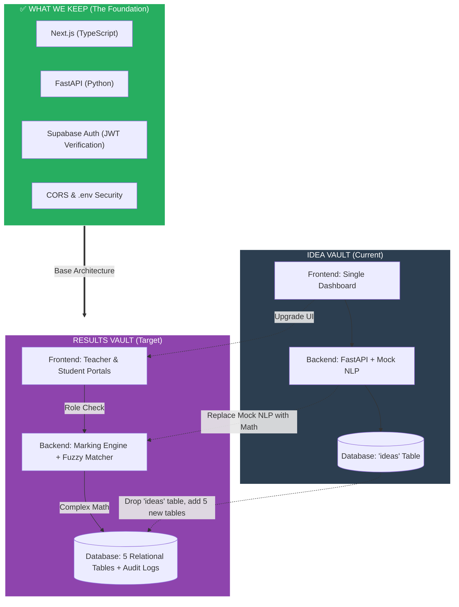

# RESULTS VAULT
So inorder to ensure that we still have the idea-vault app created a feature branch called results-vault
now remember git tracks changes but if we make changes in the db lets say i drop ideas table then its dropped so thts the issue
so for now keep the ideas table in supabase even tho u wont be using it in results-vault

# WHY TRANSFORM IDEA-VAULT TO RESULTS-VAULT 
Here is the exact breakdown of both architectures, followed by a visual "Transformation Diagram" showing exactly what we keep, what we throw away, and what we add.

---

### 🏗️ 1. Idea Vault Architecture (Where you are now)
**The Analogy:** A simple personal diary. 
*   **Frontend:** One single dashboard. You log in, see a form to add an idea, and a list of your ideas.
*   **Backend:** Receives requests, checks your JWT token to ensure you are who you say you are, runs a simple string-matching "Mock NLP" to generate tags, and saves it.
*   **Database:** One single table (`ideas`). If you want an idea, you ask for it. Very simple, linear flow.

### 🏗️ 2. Results Vault Architecture (Where we are going)
**The Analogy:** A highly secure bank.
*   **Frontend:** Two completely different views. A **Teacher Dashboard** (to input marks, see analytics, and publish results) and a **Student Portal** (to view their own published marks).
*   **Backend:** Much heavier. It verifies the JWT, checks if you are a Teacher or Student (Role-Based Access Control), runs complex math (rounding to 0.5, handling "Answer 2 of 4"), and uses a Fuzzy Matcher to guess who a messy handwritten paper belongs to.
*   **Database:** 5 highly relational tables (`students`, `papers`, `questions`, `scripts`, `marks`). It has strict constraints (no duplicate roll numbers in the same section) and an **Immutable Audit Log** (a database trigger that logs every time a mark is changed and prevents anyone from deleting that log).

---

### 🔄 3. The Transformation Diagram

Here is the visual of what stays, what goes, and what is added.

### 🗑️ What We Let Go
1.  **The `ideas` table:** We will drop this from the database.
2.  **Mock NLP:** The `if "app" in text` logic is useless for exam marks.
3.  **Single Dashboard UI:** We are splitting it into a Teacher view and a Student view.

### 📦 What We Keep (Do not rebuild this!)
1.  **JWT Authentication:** The login system and the `jwt.decode()` verification we did yesterday stays exactly the same.
2.  **The connection setup:** `database.py`, `.env` secrets, and CORS middleware.
3.  **The Tech Stack:** Next.js, FastAPI, and Supabase remain the exact same.

### ✨ What We Add
1.  **5 New Tables:** `students`, `papers`, `questions`, `answer_scripts`, `question_marks`.
2.  **RBAC (Role-Based Access Control):** The backend must check if the user is a Teacher or a Student.
3.  **The Marking Engine:** Pure Python math for rounding and choice groups.
4.  **Database Triggers:** A Postgres function that creates an un-deletable audit trail.

---

**Does this make the transformation clear?** If you are ready, we can start building the 5 new tables in Supabase (Day 2)!
