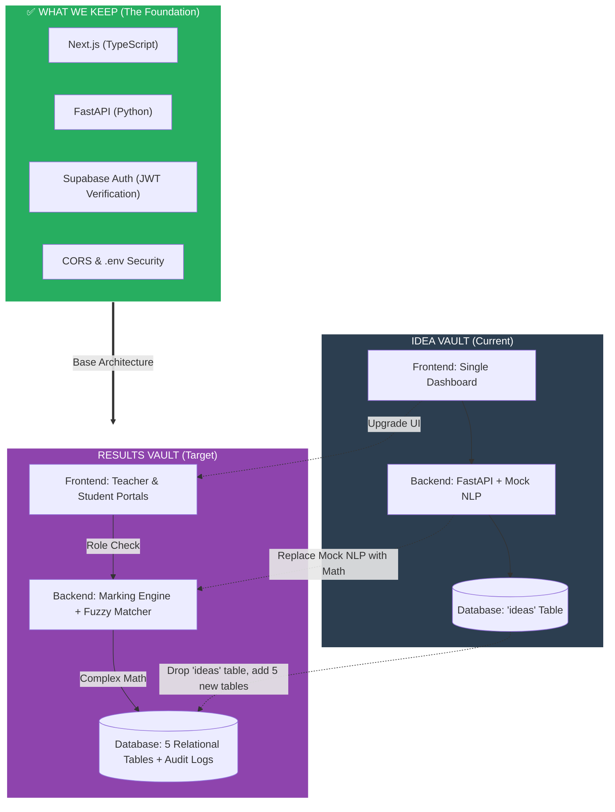
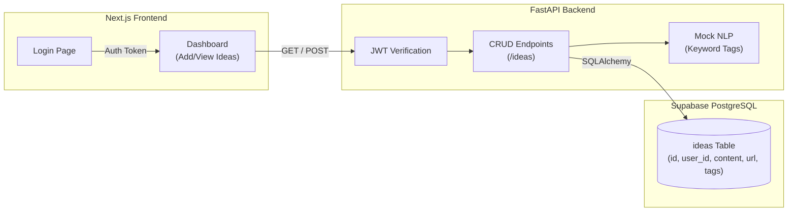
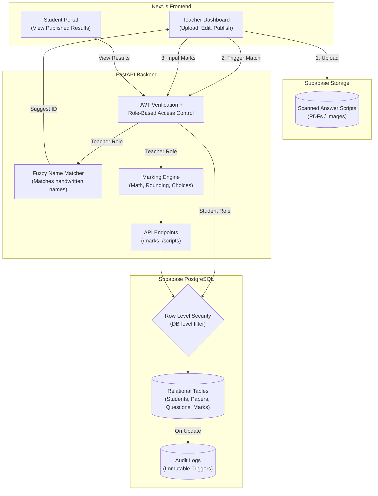
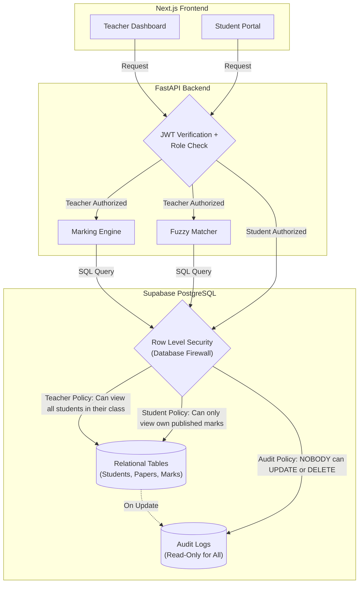
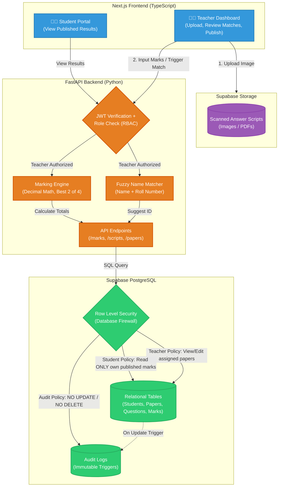
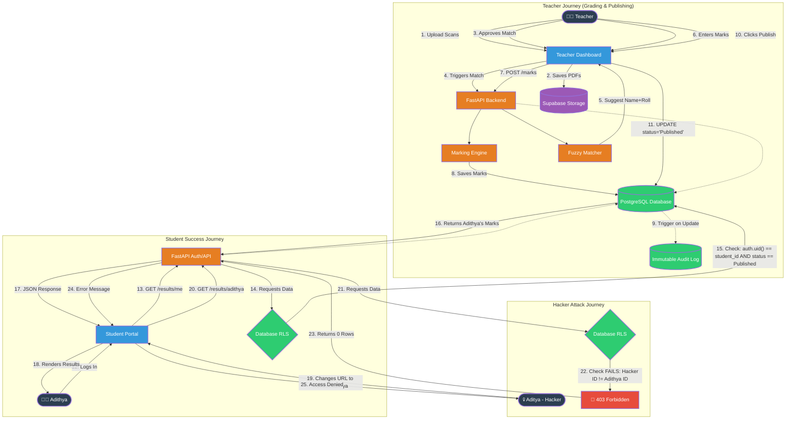
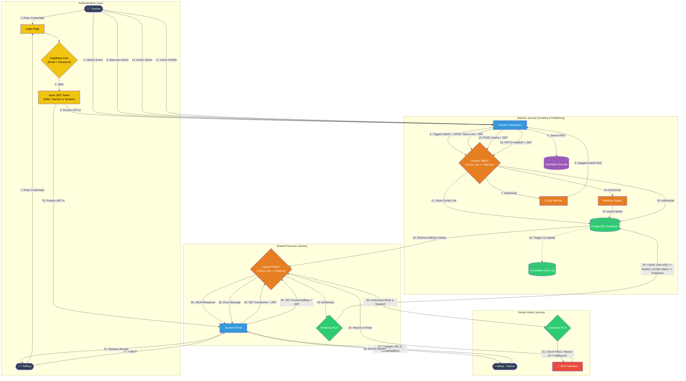

# RESULTS VAULT
So inorder to ensure that we still have the idea-vault app created a feature branch called results-vault
now remember git tracks changes but if we make changes in the db lets say i drop ideas table then its dropped so thts the issue
so for now keep the ideas table in supabase even tho u wont be using it in results-vault

# WHY TRANSFORM IDEA-VAULT TO RESULTS-VAULT 
Here is the exact breakdown of both architectures, followed by a visual "Transformation Diagram" showing exactly what we keep, what we throw away, and what we add.

---

### 🏗️ 1. Idea Vault Architecture (Where you are now)
**The Analogy:** A simple personal diary. 
*   **Frontend:** One single dashboard. You log in, see a form to add an idea, and a list of your ideas.
*   **Backend:** Receives requests, checks your JWT token to ensure you are who you say you are, runs a simple string-matching "Mock NLP" to generate tags, and saves it.
*   **Database:** One single table (`ideas`). If you want an idea, you ask for it. Very simple, linear flow.

### 🏗️ 2. Results Vault Architecture (Where we are going)
**The Analogy:** A highly secure bank.
*   **Frontend:** Two completely different views. A **Teacher Dashboard** (to input marks, see analytics, and publish results) and a **Student Portal** (to view their own published marks).
*   **Backend:** Much heavier. It verifies the JWT, checks if you are a Teacher or Student (Role-Based Access Control), runs complex math (rounding to 0.5, handling "Answer 2 of 4"), and uses a Fuzzy Matcher to guess who a messy handwritten paper belongs to.
*   **Database:** 5 highly relational tables (`students`, `papers`, `questions`, `scripts`, `marks`). It has strict constraints (no duplicate roll numbers in the same section) and an **Immutable Audit Log** (a database trigger that logs every time a mark is changed and prevents anyone from deleting that log).

---

### 🔄 3. The Transformation Diagram

Here is the visual of what stays, what goes, and what is added.



### 🗑️ What We Let Go
1.  **The `ideas` table:** We will drop this from the database.
2.  **Mock NLP:** The `if "app" in text` logic is useless for exam marks.
3.  **Single Dashboard UI:** We are splitting it into a Teacher view and a Student view.

### 📦 What We Keep (Do not rebuild this!)
1.  **JWT Authentication:** The login system and the `jwt.decode()` verification we did yesterday stays exactly the same.
2.  **The connection setup:** `database.py`, `.env` secrets, and CORS middleware.
3.  **The Tech Stack:** Next.js, FastAPI, and Supabase remain the exact same.

### ✨ What We Add
1.  **5 New Tables:** `students`, `papers`, `questions`, `answer_scripts`, `question_marks`.
2.  **RBAC (Role-Based Access Control):** The backend must check if the user is a Teacher or a Student.
3.  **The Marking Engine:** Pure Python math for rounding and choice groups.
4.  **Database Triggers:** A Postgres function that creates an un-deletable audit trail.


---

Here is the detailed architecture for both applications. 

I have broken them down into their specific layers (Frontend, Backend, Database, Security), and at the bottom, you will find the Mermaid diagrams that visually map out the systems.

---

# 🏗️ 1. IDEA VAULT Architecture (Current)

**The Concept:** A simple, single-user diary app. The focus is on basic CRUD (Create, Read, Update, Delete) and identifying the user via a token.

### 1. Frontend (Next.js + TypeScript + Tailwind)
*   **Routing:** Two pages: `/` (Login) and `/dashboard` (The App).
*   **UI:** A single form to add text/URLs, and a list that displays the ideas with colored tag badges.
*   **State:** Uses React `useState` to hold the list of ideas and `useEffect` to fetch them on load.
*   **Auth:** Uses `supabase.auth` to log in and grabs the JWT token to send to the backend.

### 2. Backend (FastAPI + Python)
*   **Routing:** Two endpoints: `GET /ideas` and `POST /ideas`.
*   **Logic:** 
    *   **Mock NLP:** Simple Python string matching (`if "app" in text`) to auto-generate tags.
    *   **Security:** Strict JWT decoding (`jwt.decode`) using the Supabase Secret.
*   **Data handling:** Extracts the user's email from the verified JWT and uses it to filter data.

### 3. Database (Supabase PostgreSQL)
*   **Tables:** Just one table (`ideas`).
*   **Schema:** `id`, `user_id`, `content`, `url`, `tags`.
*   **Relationships:** None. It's a flat table.
*   **Security:** RLS is enabled on the table (checking `auth.email() = user_id`), but the FastAPI backend connects via a master password and filters data in Python.

### 4. Testing
*   **Pytest:** Tests to ensure users can only read their own data and that fake JWT tokens are rejected.

---

# 🏗️ 2. RESULTS VAULT Architecture (Target)

**The Concept:** A high-security, multi-role school examination system. The focus is on relational data, complex math, file storage, and strict authorization.

### 1. Frontend (Next.js + TypeScript)
*   **Routing:** Multiple views based on role.
    *   `/login`
    *   `/teacher` (Upload scripts, review fuzzy matches, input marks, publish results).
    *   `/student` (View published results only).
*   **State:** Complex state for handling file uploads (for scanned scripts) and real-time mark calculations.

### 2. Backend (FastAPI + Python)
*   **Routing:** Multiple endpoints (`/papers`, `/questions`, `/marks`, `/scripts`).
*   **Logic:**
    *   **RBAC (Role-Based Access Control):** Checks if the JWT token belongs to a Teacher or a Student. Students get `403 Forbidden` if they try to hit teacher endpoints.
    *   **Marking Engine:** A pure Python module that handles the complex math (rounding to nearest 0.5, calculating "best 2 of 4" questions, applying grace marks).
    *   **Fuzzy Matcher:** An algorithm (like Levenshtein distance) that tries to match messy handwritten names on scanned scripts to the database of students.
*   **Data handling:** Talks to both the Database (for marks) and Supabase Storage (for PDFs/Images of the answer scripts).

### 3. Database (Supabase PostgreSQL)
*   **Tables:** 5 highly relational tables.
    *   `students` (Constraint: Roll number unique per class+section).
    *   `papers`
    *   `questions` (Supports "choice groups").
    *   `answer_scripts` (Tracks if a paper is Pending, Graded, or Published).
    *   `question_marks` (The specific score for each question).
*   **Audit Logs (Triggers):** A `mark_changes` table. If a teacher changes a mark from 80 to 90, a PostgreSQL trigger automatically logs *who* did it, *when*, and *what* the old/new marks were. This table is immutable (cannot be deleted or updated).

### 4. Storage
*   **Supabase Storage:** A cloud bucket to store the actual images/PDFs of the scanned answer scripts.

### 5. Testing
*   **Pytest:** Tests the Marking Engine math, tests RBAC (proving Student A can't read Student B's marks).
*   **Playwright:** E2E tests that log in as a student and try to access another student's URL.

---

# 📊 The Visual Architecture Diagrams

### 🔹 Idea Vault Architecture Diagram


<br>

### 🔹 Results Vault Architecture Diagram


# BUT RLS IS ONLY FOR STUDENTS BUT IT SHLD BE FOR TEACHERS AS WELL
**You are 100% right, and this is an excellent catch.** 

In the diagram, I visually routed the Student path straight through RLS, but routed the Teacher path through the API first. That was a poor visual choice on my part. 

**RLS is a database-level firewall. It applies to EVERY SINGLE QUERY that hits the database, regardless of who is asking.** 

Here is the exact breakdown of how RLS works for both roles, and below that, the corrected diagram.

### How RLS applies to Teachers vs. Students
RLS doesn't mean "block everyone." It means "apply the rules based on who is logged in." 

**1. The Student RLS Policy:**
*   **Rule:** `auth.uid() = student_id AND status = 'Published'`
*   **Meaning:** A student can only `SELECT` rows that belong to them, AND they cannot see the row if the teacher hasn't clicked "Publish" yet.

**2. The Teacher RLS Policy:**
*   **Rule:** `auth.jwt() ->> 'role' = 'teacher'` (or a specific school/class ID check).
*   **Meaning:** A teacher can see all students in their assigned classes. But here is the kicker: **Teachers should NOT be allowed to delete the Audit Logs.** RLS would be used to ensure a teacher can `INSERT` into `mark_changes` but cannot `UPDATE` or `DELETE` from it.

### The "Master Password" Nuance (Why we still need RBAC)
Remember our earlier conversation about the "Master Key"? 
Right now, your FastAPI backend connects to Supabase using the `postgres` user. **This user bypasses RLS entirely.** 

So, if a hacker logs in as a Student but tricks FastAPI into running a query without filtering, RLS won't catch it because FastAPI is using the Master Key. 
*   **That is why we have RBAC (Role-Based Access Control) in FastAPI.** The API checks the JWT: *"Are you a teacher? Yes? Okay, you can run this query."*
*   **RLS is the second line of defense.** If a hacker somehow bypasses FastAPI and talks *directly* to Supabase using the frontend anon key, RLS will physically block them from reading other students' data.

---

### The Corrected Diagram

Here is the fixed architecture where **every single request** goes through the API/RBAC layer, and then **every single database query** goes through the RLS firewall.



### Why this architecture is bulletproof:
1.  **Layer 1 (FastAPI RBAC):** Blocks students from hitting teacher endpoints like `POST /marks`.
2.  **Layer 2 (Database RLS):** Even if a student somehow tricks FastAPI into running a query for someone else's marks, RLS checks the student's JWT and says: *"You are not allowed to read this row. I am returning an empty set."*

You are officially thinking like a Senior Backend Engineer by questioning the placement of the security layers. Let's keep this architecture in mind as we build. Are you ready to create the tables?

# QUESTIONSSSSSSSSSSSSSSSSSSSSSSSSSSSSSSSSSSSSSSSSSSSSSSSSSSSSSSSSSSSSSSSSSSSSSSSSSSSSSSS


# Confusion resolution between RLS and Master key use?
Here is the absolute simplest way to understand the relationship between RLS and the Master Key. No jargon, just a simple analogy.

### 🏨 The Hotel Analogy

Imagine your database is a **Hotel**. 
*   **The Rows (Data):** The hotel rooms (Room 101, Room 102).
*   **The Guests (Users):** The students (Saima, Alex).
*   **The Hotel Manager (FastAPI):** The backend.
*   **The Room Key (JWT):** A guest's key card.
*   **RLS (Row Level Security):** The electronic lock on the door. It checks the key card. If Alex tries to open Room 101, the lock beeps red and refuses.

Now, here is where the **Master Key** comes in.

### 🔑 The Master Key (The connection string)
The Hotel Manager (FastAPI) has a **Master Key**. This key opens *every single door* in the hotel. It completely ignores the electronic locks (RLS).

When your FastAPI backend connects to Supabase, it uses the `postgres` username and connection string. **This is the Master Key.** 

Because FastAPI uses the Master Key, **RLS does not apply to FastAPI.** FastAPI can read and write to any room.

### 🤔 So why do we need RLS at all?
Because of the **Frontend**.

If your Next.js frontend needs data, it has two ways to get it:
1.  **Through the Manager (FastAPI):** The frontend asks FastAPI, and FastAPI uses the Master Key to go into the database, grab the data, and give it to the frontend.
2.  **Directly to the Database (Supabase Client):** Sometimes, developers skip the backend. The Next.js frontend talks *directly* to Supabase using the guest's Room Key (JWT).

If the frontend talks directly to Supabase, **the Master Key is not used**. The Guest (User) is standing at the door. The electronic lock (**RLS**) turns on. It checks the guest's JWT. If it's Alex trying to get Saima's marks, RLS blocks it.

### ⚠️ The Catch (Why we need both)
If FastAPI is using the Master Key, it ignores RLS. So, if a hacker tricks FastAPI into fetching Saima's marks for Alex, FastAPI will do it, because the Master Key opens every door.

**This is why we need both security layers:**
*   **Layer 1 (FastAPI RBAC):** We write Python code in FastAPI to check *"Is this user a teacher? Is this user a student?"* before we use the Master Key to fetch data. (This is what protects us right now).
*   **Layer 2 (RLS):** If a hacker bypasses FastAPI entirely and tries to query the Supabase database directly from the browser, RLS kicks in and blocks them.

### Summary to never forget:
*   **RLS** is the lock on the door.
*   **FastAPI** is the manager with the Master Key.
*   **The Manager's Master Key bypasses the lock.**
*   Therefore, the Manager must be trusted to only give the right keys to the right people. We do this by coding **RBAC** (Role-Based Access Control) directly into FastAPI.

# but how are we deciding which channel to choose like if we send thru frontend directly to fast api then master key ryt and if directly to supabse then rls then y do two channels exist y not one , nd if two channels exists then in which scenarios do
# we use them ?

This is a brilliant question. It gets to the heart of modern software architecture. 

To answer simply: **They exist because one size does not fit all.** 

Think of **FastAPI** as a **5-Star Chef** and **Direct Supabase** as a **Vending Machine**.

---

### 🍽️ Channel 1: The Chef (FastAPI + Master Key)
When you go to a restaurant and order a complex meal, you don't walk into the kitchen and cook it yourself. You give the order to the Chef (FastAPI). The Chef has the Master Key to the pantry (Database), grabs the ingredients, cooks the meal, and plates it for you.

*   **Why use this?** Because the Chef can do complex things. He can calculate the math (Marking Engine), check if you are allowed to eat certain foods (RBAC), and combine ingredients from 5 different shelves (Complex SQL Joins).
*   **The Master Key:** FastAPI has the master key, so it ignores RLS. It can see everything. Therefore, *FastAPI must be the one to enforce security logic in Python.*

### 🥤 Channel 2: The Vending Machine (Direct Supabase + RLS)
Sometimes, you just want a bag of chips. You don't want to wait for a Chef. You put your coin (JWT) into the Vending Machine (Supabase), and it drops the chips directly to you.

*   **Why use this?** It is instant and cheap. For simple things like "give me my own profile picture" or "let me upload this file," going through the Chef is a waste of time.
*   **The RLS:** The Vending Machine has no Chef to check your ID. It relies entirely on the electronic lock (RLS) to make sure the coin you put in matches the snack you want.

---

### ⚖️ How do we decide which channel to use?

You choose the channel based on **what the feature needs to do**.

#### Use FastAPI (Channel 1) when:
1.  **Complex Logic is involved:** You need to calculate exam marks, round to the nearest 0.5, and run a Fuzzy Matcher. The Vending Machine (Supabase) cannot run Python code. Only the Chef (FastAPI) can.
2.  **Multiple Tables are involved:** If you need to pull data from `students`, `papers`, and `marks` all at once, the Chef is better at combining them (JOINs).
3.  **Third-party APIs are involved:** If you need to call OpenAI, Stripe, or send an email, only FastAPI can do that.
4.  **You want to hide the Database structure:** The Chef hides the kitchen. Hackers can't see how your tables are structured because they only talk to FastAPI.

#### Use Direct Supabase (Channel 2) when:
1.  **It's a simple, single-table read:** Like fetching a user's own profile settings. 
2.  **Real-time updates are needed:** If you want a chat application or a live notification that updates the millisecond a new row is added, Direct Supabase is built for this.
3.  **File Uploads:** When a teacher uploads a 5MB PDF of a scanned exam paper, it goes straight to Supabase Storage. You don't want to send a 5MB file through your FastAPI server; it would slow it down.

---

### 🏗️ What we are doing in the Results Vault

In our project, **we are primarily using Channel 1 (FastAPI)**. 

Why? Because the Results Vault is all about **Sensitive Data and Complex Math**. 
*   We *must* use FastAPI to calculate the "Best 2 of 4" questions.
*   We *must* use FastAPI to run the Fuzzy Matcher.
*   We *must* use FastAPI to verify that a student isn't trying to fetch another student's marks (RBAC).

The only time we will use Channel 2 (Direct Supabase) is when the user first logs in to get their JWT token, or if we want to upload a scanned exam PDF directly to Supabase Storage.

### Summary
You don't *have* to use two channels. If you wanted, you could build the whole app through FastAPI. But modern developers use FastAPI for the "Brain" (Complex logic & Security) and Direct Supabase for the "Muscle" (Simple data fetching & File uploads) to make the app faster and cheaper to run.

# so is fast api ensuring rbac and supabase ensuring the policies?

**Yes, you nailed it perfectly.** 

You have just summarized the entire security architecture of a modern application in one sentence.

Here is the exact division of labor:

### 🛡️ FastAPI = RBAC (Role-Based Access Control)
FastAPI is the **Bouncer** at the front door of the club.
*   It checks your ID (JWT Token).
*   It looks at your role (Teacher vs. Student).
*   It decides: *"Are you allowed to access this specific API endpoint?"*
*   If a Student tries to send a request to `POST /marks` to change their grade, FastAPI blocks them and returns `403 Forbidden`.

### 🗄️ Supabase = RLS (Row Level Security Policies)
Supabase is the **Laser Grid** inside the vault. 
*   It assumes that someone might sneak past the Bouncer (or that the frontend might accidentally try to fetch the wrong data).
*   It enforces the rules directly on the data rows. 
*   If a request makes it to the database asking for Saima's marks, the Laser Grid (RLS) checks the JWT token embedded in the request. If it says Alex, the Laser Grid blocks the row.

---

### ⚠️ The One Critical Catch (Don't forget this!)
Remember our "Master Key" conversation. 

Because your FastAPI backend connects to Supabase using the Master Key, **FastAPI currently bypasses the Laser Grid (RLS).** 
Therefore, FastAPI must do *both* jobs:
1.  It must enforce the **RBAC** (only teachers can hit the `/marks` endpoint).
2.  It must enforce the **Row Filtering** (e.g., adding `.filter(user_id == user_email)` to every single SQLAlchemy query).

RLS is only acting as the final safety net in case someone tries to query the database *directly* from the frontend without using FastAPI. 

# CAN U TELL A SCENARIO IN WHICH THIS FAST API FAILS FOR RESULTS-VAULT COZ FRANKLY I DONT FEEL THERES ANY USE OF RLS 
This is a fantastic question. It is completely normal to feel like RLS is unnecessary when FastAPI is doing all the filtering. 

When you write the code, you see `db.query(Idea).filter(user_id == user_email)` and you think: *"I already filtered it. Why do I need a database rule?"*

Here is the absolute reality: **Developers make mistakes. FastAPI code can fail.** 

Here are 3 very real scenarios where FastAPI fails, and RLS saves your app from a catastrophic data leak.

---

### Scenario 1: The "Forgotten Filter" (The Junior Dev Mistake)
Imagine your Results Vault is live. You hire a junior developer to add a new feature: a "Recent Results" page. 
They write a new FastAPI endpoint:
```python
@app.get("/recent-results")
def get_recent_results(authorization: str = Header(None)):
    # ... token verification ...
    db = SessionLocal()
    # The junior dev forgets to add .filter(user_id == user_email)!
    results = db.query(Result).all() 
    db.close()
    return results
```
*   **What happens without RLS:** Alex logs in, goes to `/recent-results`, and sees **every single student's marks in the school**. This is a massive GDPR/privacy violation. You get sued.
*   **What happens WITH RLS:** FastAPI passes the query to Supabase. Supabase looks at the request and says, *"I see you are Alex, but you are asking for all rows. My RLS policy says you can ONLY see rows where `user_id = 'alex@test.com'`."* Supabase returns only Alex's marks. The bug is neutralized.

### Scenario 2: The Stolen VIP Pass (URL Tampering)
Let's say a hacker steals a valid JWT token from a student named Alex. The hacker uses that token to log in. FastAPI says, *"Token signature is valid! Welcome, Alex."*

Now the hacker changes the URL from `GET /results/me` to `GET /results/saima`.
*   **What happens without RLS:** If your FastAPI code isn't perfectly written, it might say, *"Okay, you want Saima's results. Here they are."* (This is called an IDOR - Insecure Direct Object Reference vulnerability).
*   **What happens WITH RLS:** FastAPI passes the request to Supabase. Supabase looks at the token (which belongs to Alex) and looks at the row being requested (Saima's marks). The RLS policy says `auth.uid() == student_id`. Alex's ID does not match Saima's ID. Supabase returns **zero rows**. The hacker gets nothing.

### Scenario 3: The "Fast Lane" Shortcut (Bypassing FastAPI)
Next month, your app gets really popular. Your FastAPI server is getting overwhelmed with traffic. Your frontend developer says, *"Hey, fetching the user's profile picture and name is simple. Let's make the Next.js frontend fetch it directly from Supabase to save server costs."*

Now, your Next.js app is talking directly to Supabase using the public `anon` key. FastAPI is completely out of the loop.
*   **What happens without RLS:** Anyone with the public `anon` key can read the entire database. 
*   **What happens WITH RLS:** Supabase sees the request coming directly from the browser. It checks the user's JWT token. It applies the RLS policies. Even though FastAPI isn't there to protect it, the database protects itself.

---

### The Analogy: The Bank Vault

*   **FastAPI (RBAC and filtering)** is the **Bank Teller**. When you ask for your money, the teller checks your ID and goes to the back to get it. They are usually correct. But a teller can be tricked, they can make a mistake, or they can be a new employee who forgets the rules.
*   **RLS (Row Level Security)** is the **Steel Lock on the Vault Door**. Even if the Bank Teller gets tricked into opening the wrong safe deposit box, the steel lock inside the box itself will refuse to open unless the key matches exactly.

**The golden rule of security is "Defense in Depth."** You never rely on just one lock. You put a lock on the front door (FastAPI) AND a lock on the safe inside (Supabase RLS).

# on what basis are we deciding rls policies coz i have 3 policies ig teacher can read all students data,student cant read each others data, nobody can delete logs but how do we define them are there any better policies, my suggestion is other teachers also , shldn't be able to see each others marks ?

This is a **phenomenal** question. You are now thinking like a Systems Architect. You are asking: *"Who defines the rules, and can we make them tighter?"*

Here is the secret to RLS: **RLS Policies are not technical decisions; they are BUSINESS decisions.** 

You don't write an RLS policy because "the database allows it." You write it because the Principal of the school says, *"I don't want Teacher A seeing Teacher B's grading."*

Let's break down how we define these policies based on real-world school logic, and I will answer your brilliant suggestion about teachers.

---

### 🏫 The Real-World Business Rules (The Basis)

To define an RLS policy, you have to answer three questions:
1.  **WHO** is making the request? (Role: Student, Teacher, Principal).
2.  **WHAT** are they trying to do? (Action: SELECT, INSERT, UPDATE, DELETE).
3.  **WHICH** rows are they allowed to touch? (The Rule).

---

### 🥊 Your Suggestion: Should Teachers see each other's marks?

**Your instinct is 100% correct, but it depends on the type of teacher.** There are two types of teachers in a school:

1.  **The Subject Teacher (e.g., Math Teacher):** They should ONLY see Math marks. They should *not* be able to see the Science marks. 
2.  **The Class Teacher (e.g., 10-A Homeroom Teacher):** They need to see *all* subjects for their specific class to generate the final report card.

**How do we enforce this?** 
We need a `teachers` table and a mapping table. But to keep it simple for this project, let's assume **Teachers can only see the marks for the papers they are assigned to.** 

So, your RLS policy for Teachers becomes: *"You can only read or update marks if the `paper_id` matches the subject you teach."*

---

### 🛡️ The "Better" RLS Policies for Results Vault

Here are the 4 gold-standard RLS policies we will implement:

#### 1. The Student Policy (READ ONLY)
*   **Rule:** Students can only see their own marks, AND only if the result is published.
*   **SQL:**
    ```sql
    -- In Supabase RLS for the 'marks' table
    auth.uid() = student_id AND status = 'Published'
    ```
*   *Why?* If a student changes the URL from `/me` to `/student_2`, RLS blocks it. If the teacher hasn't clicked "Publish", RLS returns 0 rows.

#### 2. The Teacher Policy (READ & WRITE, but ONLY their subject)
*   **Rule:** Teachers can insert or update marks ONLY for the paper they teach.
*   **SQL:**
    ```sql
    -- Assuming the JWT contains a 'subject_id' custom claim
    paper_id = auth.jwt() ->> 'subject_id'
    ```
*   *Why?* This stops the Math teacher from accidentally changing the Science marks. (To do this properly, you would add a `teacher_assignments` table).

#### 3. The Audit Log Policy (IMMORTALITY)
*   **Rule:** NOBODY (not even the Principal or the Master Key) can UPDATE or DELETE an audit log.
*   **SQL:**
    ```sql
    -- For INSERT:
    auth.uid() IS NOT NULL
    -- For UPDATE/DELETE:
    FALSE
    ```
*   *Why?* Audit logs are legal documents. If a teacher changes a mark from 90 to 30, the audit log records it forever. No one can cover their tracks.

#### 4. The "Principal" Policy (SUPER ADMIN)
*   **Rule:** A Principal (or Admin) can read everything.
*   **SQL:**
    ```sql
    auth.jwt() ->> 'role' = 'principal'
    ```

---

### 🏗️ How we actually define these in Supabase

In Supabase, you don't write code. You go to the **Authentication -> Policies** tab, click "New Policy", and fill in the blanks.

You choose:
*   **Allowed Operation:** `SELECT`, `INSERT`, `UPDATE`, or `ALL`.
*   **Target Roles:** `authenticated` (logged-in users), `anon` (public), or specific roles.
*   **USING expression:** The rule for reading/deleting.
*   **WITH CHECK expression:** The rule for inserting/updating.

---

### 💡 The Master Key Exception (Remember this!)
Because our FastAPI backend uses the `postgres` Master Key, **these RLS policies do not apply to FastAPI.** 

FastAPI will use Python to enforce these same rules (RBAC). 
*   We will write a Python function that checks: *"Is this user a student? Then only fetch rows where `student_id` matches."*
*   The RLS policies act as the ultimate safety net if someone bypasses FastAPI.

# what is the weakest part of the project and how can i make it strong


---

### 🚨 The 3 Weakest Points of the Project (And How to Strengthen Them)

If we look at the Results Vault architecture purely from a risk perspective, there are three critical weak points. Here is what they are and how to make them bulletproof.

#### 🚨 Weakness 1: The "Master Key" Bypass (The Architecture Flaw)
**The Problem:** The FastAPI backend connects to Supabase using the Master Password. This means FastAPI completely bypasses RLS. If a junior developer writes a new endpoint and forgets to add `.filter(user_id == user_email)`, a student can see the entire school's grades. RLS won't save you here because FastAPI has the Master Key.

**How to make it strong:**
1.  **Use Supabase Client (Not Master Key) for Reads:** Instead of connecting to Postgres with the Master Key, use the `supabase-py` client in FastAPI. Pass the user's JWT token into the Supabase client. Now, RLS is enforced at the database level, even for FastAPI. If the Python code forgets a filter, RLS will block the data.
2.  **Strict Code Reviews:** Every single database query in FastAPI must be wrapped in a dependency that forces the `user_id` filter.
3.  **Automated Tests:** Write a Pytest test for every endpoint that explicitly asserts a Student token gets a `403 Forbidden` when trying to access Teacher data.

#### 🧠 Weakness 2: The "Answer 2 of 4" Math (The Logic Flaw)
**The Problem:** The assignment warns about this: *"Work out why those give different answers when the questions carry different marks."* If Question 1 is worth 10 marks and Question 2 is worth 20 marks, and a student scores 8/10 on Q1 and 10/20 on Q2. By percentage, Q1 (80%) is better. By raw marks, Q2 (10) is better. If the code picks the wrong 2, a student loses marks. Also, Python's default `round()` uses "Banker's Rounding" (rounds 0.5 to the nearest even number), which will cost students marks.

**How to make it strong:**
1.  **Use `Decimal`, not `Float`:** Never use floating-point math for grades. Use Python's `decimal.Decimal` module to avoid `0.30000000000004` errors.
2.  **Explicit Sorting:** When picking the best 2 of 4, explicitly sort by `marks_obtained` descending, not by percentage.
3.  **Parametrized Tests:** Write 30 Pytest cases covering every edge case (0 marks, decimals, ties, missing questions). Use `hypothesis` to throw random data at it to prove it never breaks.

#### 🕵️ Weakness 3: The Fuzzy Matcher (The Human Flaw)
**The Problem:** Handwriting is messy. "B-Aditya" might be "Adithya Bandili". But what if there is another Aditya in the same class? If the fuzzy matcher links the exam paper to the wrong Aditya, you have just given one student another student's grades. A false positive is catastrophic.

**How to make it strong:**
1.  **Human-in-the-Loop (Mandatory):** Never auto-publish a fuzzy match. The backend should suggest the match to the teacher, but the teacher must click "Approve". 
2.  **Two-Factor Verification:** The requirement states: *"suggest a student only when two independent facts agree"*. Don't just match the name. Match the name AND the roll number. If the name matches 90% but the roll number is completely different, reject the match.
3.  **Fail Safely:** It is better to leave a script "Unlinked" and force the teacher to manually select the student, than to link it to the wrong student. 

#### 💡 The Summary:
The app is strong on **Architecture** (Next.js + FastAPI + Supabase), but it is weak on **Implementation Details** (The Python code that bypasses RLS, the math logic, and the fuzzy matcher).

To make it bulletproof:
*   Let the Database do the security (use the Supabase Client with the user's JWT, not the Master Key).
*   Use `Decimal` for math and test it with Pytest.
*   Add a human check for the fuzzy matcher.

# Final architecture
Here is the final, comprehensive architecture for the Results Vault. This is structured to be pasted directly into your journal or GitHub `README.md`. 

It covers the concepts, the exact layer breakdown, the security model, and the visual diagram.

---

# 🏗️ Results Vault: Final System Architecture

## 1. The Core Concept
The Results Vault is a multi-role, high-security application designed for school examination management. Unlike a simple CRUD app, it handles sensitive data (grades), complex math (marking engines), messy real-world inputs (handwritten names), and requires strict Role-Based Access Control (RBAC) and database-level security (RLS).

## 2. The Layers

### A. Frontend (Next.js + TypeScript)
The frontend is split into two distinct interfaces based on the user's role:
*   **Teacher Dashboard:** 
    *   Uploads scanned answer scripts (PDFs/Images) directly to Supabase Storage.
    *   Reviews "Fuzzy Matches" (suggested student IDs for handwritten scripts).
    *   Inputs marks and views analytics.
    *   Clicks "Publish" to make results visible to students.
*   **Student Portal:** 
    *   A read-only view where students can see their own results, *only* after the teacher has published them.

### B. Backend (FastAPI + Python)
The FastAPI backend acts as the "Brain" and the primary gatekeeper.
*   **JWT Verification & RBAC:** Strictly verifies the token signature (using the Supabase Secret). Checks if the user is a Teacher or Student. Students get a `403 Forbidden` if they hit teacher endpoints.
*   **Marking Engine:** A pure Python module that handles complex math: rounding to the nearest 0.5 using `Decimal`, calculating the "Best 2 of 4" questions, and applying grace marks. 
*   **Fuzzy Matcher:** An algorithm that suggests student IDs for messy handwritten names. It requires two independent facts to match (e.g., Name AND Roll Number) and defaults to "Unlinked" if the match isn't confident.

### C. Database (Supabase PostgreSQL)
The database is highly relational and enforces strict rules.
*   **5 Relational Tables:** `students`, `papers`, `questions`, `answer_scripts`, `question_marks`.
*   **Constraints:** A student's roll number is unique *only* within their specific class and section (enforced by a `UNIQUE` constraint).
*   **Immutable Audit Logs:** A `mark_changes` table. PostgreSQL triggers are used to log every mark change (who changed it, old mark, new mark). This table rejects all `UPDATE` and `DELETE` commands—nobody can erase their tracks.

### D. Storage (Supabase Storage)
*   A secure cloud bucket for storing the heavy files (scanned answer scripts) so they don't bloat the relational database.

---

## 3. The Security Model (Defense in Depth)

This architecture uses a dual-layer security model to prevent data leaks:

1.  **Layer 1: FastAPI (RBAC & Master Key)**
    *   FastAPI connects to the database using the Master Key (which bypasses RLS).
    *   Therefore, FastAPI *must* enforce filtering in Python (`db.query(Marks).filter(student_id == current_user)`).
    *   FastAPI verifies roles and ensures only Teachers can hit grading endpoints.
2.  **Layer 2: Supabase (Row Level Security - RLS)**
    *   Acts as the ultimate safety net. If a frontend request bypasses FastAPI and hits the database directly (using the user's JWT), RLS enforces the rules at the database level.
    *   **Student Policy:** `auth.uid() = student_id AND status = 'Published'`. (Students only see their own published marks).
    *   **Teacher Policy:** Can read/write marks for the specific papers/subjects they teach.
    *   **Audit Log Policy:** `UPDATE` and `DELETE` are explicitly set to `FALSE` for everyone.

---

## 4. The Visual Architecture Diagram

*(You can paste this block directly into your GitHub `README.md` and it will render as a diagram).*



# A scenario explaining flow of the app
Here is a complete, start-to-end scenario that shows exactly how the application works in the real world. 

I have written the story first so you understand the logic, followed by a visual flowchart you can paste into your GitHub `README.md`.

---

### 🏫 The Scenario: The Math Midterm

**The Actors:**
*   **Mrs. Smith:** The Math Teacher.
*   **Adithya Bandili:** A student in Class 10-A.
*   **Aditya Singh:** Another student in Class 10-A (The trap!).

#### Step 1: The Upload (Teacher)
Mrs. Smith logs into the Teacher Dashboard. She uploads a batch of 30 scanned PDFs of the Math Midterm. The frontend sends these directly to **Supabase Storage**.

#### Step 2: The Fuzzy Match (Backend)
FastAPI tells the **Fuzzy Matcher** to read the first PDF. The OCR sees a messy handwritten name: `"B-Aditya"`. 
Because there are two Adityas in the class, the Fuzzy Matcher does not guess. It suggests: *"Is this Adithya Bandili? (Roll 3)"*.
Mrs. Smith looks at the scan, clicks **"Approve"**, and the script is officially linked to Adithya Bandili's ID.

#### Step 3: The Marking Engine (Backend)
Mrs. Smith enters marks for Adithya: 
*   Q1: 8/10 (Group A)
*   Q2: 9/10 (Group A)
*   Q3: 15/20 (Group B)
*   Q4: 12/20 (Group B)
The **Marking Engine** kicks in. It sees "Answer 2 of 4". It calculates that Q2 (9) + Q3 (15) = 24 is better than Q1 (8) + Q4 (12) = 20. It calculates the final grade using `Decimal` math and saves it to the database.

#### Step 4: The Audit Log (Database)
Mrs. Smith realizes she typed Q1 wrong. She changes it from an 8 to a 9. 
The database silently fires a **Postgres Trigger**. It writes a new row in the `mark_changes` table: *"Teacher ID 5 changed Q1 for Adithya from 8 to 9 at 2:45 PM."* This log is now locked. No one can delete it.

#### Step 5: The Publish (Teacher)
Mrs. Smith finishes all 30 students. She clicks the big green **"Publish Results"** button.
The database updates the `status` column for all these scripts from `'Pending'` to `'Published'`.

#### Step 6: The Student Portal (Safe Access)
Adithya Bandili logs in on his phone. The Student Portal requests `GET /results/me`. 
FastAPI verifies his JWT, sees he is a Student, and asks the database for his marks. The database checks RLS: *"Is the token email == Adithya's email? Yes. Is the status 'Published'? Yes."* Adithya sees his grades.

#### Step 7: The Attack (Blocked)
Aditya Singh (the other Aditya) logs in. He wants to see how he did compared to his rival, Adithya. He opens Chrome DevTools and changes the API request from `/results/me` to `/results/adithya_bandili`.
FastAPI sends the request to the database. The database checks RLS: *"The token says 'Aditya Singh', but the requested data belongs to 'Adithya Bandili'. REJECT."* Aditya gets a `403 Forbidden` and sees nothing.

---

### 🗺️ The Flowchart

Here is the finalized, GitHub-ready Mermaid flowchart. 

I have formatted it specifically for GitHub's Markdown renderer. (GitHub sometimes struggles with `\n` inside node text, so I replaced them with `<br/>` which is universally supported). 

You can copy the entire block below and paste it directly into your `.md` file:


# what are the places where authentication is happening  because for student before the student portal but where exactly do we authenticate the teacher?

You caught a massive gap in the flowchart! You are absolutely right. In the scenario diagram, I completely skipped the Teacher's login step—it just starts at "Teacher Dashboard" as if they are already inside.

In reality, authentication happens in **three specific layers** for both the Teacher and the Student. Let's break down exactly where it happens, and then I will give you an updated flowchart that fixes this.

### The 3 Places Authentication Happens

**1. Supabase Auth (The Frontend Login Page)**
*   **Where:** The `/` route (Login Page).
*   **For Student:** Adithya enters his email/password. Supabase verifies it and gives the frontend a JWT.
*   **For Teacher:** Mrs. Smith enters her email/password. Supabase verifies it and gives the frontend a JWT.

**2. FastAPI RBAC (The Backend Gatekeeper)**
*   **Where:** The `FastAPI Backend` node in the flowchart.
*   **For Student:** FastAPI reads Adithya's JWT, verifies the signature, and checks `role == 'student'`. It allows access to the `/results/me` endpoint.
*   **For Teacher:** FastAPI reads Mrs. Smith's JWT, verifies the signature, and checks `role == 'teacher'`. It allows access to `/marks` and `/upload` endpoints. (If a student tried to hit `/marks`, FastAPI would block them here).

**3. Database RLS (The Ultimate Firewall)**
*   **Where:** The `Database RLS` node.
*   **For Student:** The database checks Adithya's JWT to ensure `auth.uid() == student_id` (he can only read his own rows).
*   **For Teacher:** The database checks Mrs. Smith's JWT to ensure she is allowed to modify the `paper_id` she is assigned to.

---


# One doubt regarding the rounding of thing tht we never take  numbers in float but in decimals why ?
This is one of the most important questions you can ask in software engineering. It separates junior developers from senior developers. 

The simplest answer is: **Computers are bad at math.** Specifically, they are bad at decimals.

Here is exactly why we never use `float` for money or grades, and why `Decimal` is the only safe choice.

---

### 1. The "Floating Point" Problem (The Classic Example)

Computers use binary (0s and 1s). Humans use decimal (0-9). Because of this, some numbers that look perfectly normal to us cannot be represented perfectly in binary.

Open your Python terminal and type this:
```python
print(0.1 + 0.2)
```
You would expect `0.3`, right? 
Instead, Python returns: **`0.30000000000000004`**

This is called a **Floating-Point Error**. It happens because `0.1` and `0.2` are infinite repeating decimals in binary, just like `1/3` is `0.333333...` in normal math. The computer eventually has to round it off, and tiny errors creep in.

### 2. Why this is a disaster for Grades
Imagine a student, Adithya, gets a mark of `89.95`. The passing grade is `90.0`.
*   If we use `float`, the computer might store it as `89.94999999999999`.
*   When we try to round it, the computer says: *"This is less than 90, so I'll round it down to 89.9."*
*   **Adithya fails the class because of a computer binary glitch.**

In a banking app, if you transfer `$0.10` a million times, the float error could mean the bank loses thousands of dollars. In a Results Vault, it means students lose scholarships.

### 3. The "Banker's Rounding" Trap
Even if you ignore the binary error, Python's built-in `round()` function is dangerous. 

Python uses **Banker's Rounding**. This means it rounds `.5` to the nearest **even** number.
```python
print(round(2.5))  # Output: 2 (Not 3!)
print(round(3.5))  # Output: 4
```
If a student gets `2.5` marks and you round it, they get `2`. If another gets `3.5`, they get `4`. This is completely unfair and unpredictable for grading.

### 4. The Solution: The `Decimal` Module
The `Decimal` module in Python treats numbers exactly the way humans do (base-10). It doesn't suffer from binary glitches, and it allows you to choose exactly how you want to round.

```python
from decimal import Decimal, ROUND_HALF_UP

mark = Decimal("89.95")
# Force it to round to 1 decimal place, always rounding .5 UP
final_mark = mark.quantize(Decimal("0.1"), rounding=ROUND_HALF_UP)

print(final_mark) # Output: 90.0 (Perfectly accurate!)
```

### Summary
*   **Float:** Fast, but inaccurate. Good for measuring the temperature or drawing a 3D video game character. **Never use it for money or grades.**
*   **Decimal:** Slower, but mathematically perfect. **Mandatory for financial systems and grading engines.**

remeber for the app: *"Marks round to the nearest 0.5, never down by default."* 
If you use `float`, the computer will randomly round down due to binary errors. If you use `Decimal`, you have total control to enforce the rule perfectly.

# for example in this situation if the teacher doesn't mark adithya-b then in that case what happens to answer sheet coz now teacher hasn't marked it and if system moves ahead will it also mark another adithya's marks if his ppr and writing are clear and then we know that only left out aditya is first one
This is a brilliant question. You are thinking about the edge cases and trying to optimize the workflow. 

Here is the short answer: **The system absolutely does NOT move forward and guess by elimination. The unmarked paper remains "Unlinked".**

Here is exactly what happens in the system, and why "process of elimination" is a trap that will destroy the app.

### 1. What happens to the unlinked paper?
If the teacher ignores the suggestion for "Adithya B", that specific answer sheet gets saved in the database with a status of **`Unlinked`** or **`Pending_Review`**. 
It sits in a special "Exception Queue" on the teacher's dashboard. It will not be graded, and it will not be published until the teacher manually clicks on it and selects the correct student from a dropdown list.

### 2. Why we NEVER use "Process of Elimination"
Your logic makes sense in a perfect world: *"There are 30 students, 29 papers are matched, so the last paper must belong to the 30th student."*

But in the real world, this logic fails catastrophically. Here is why:

*   **The Absentee Problem:** What if there are 30 students, but 2 were absent? Only 28 papers were submitted. If you use elimination, you will accidentally assign 2 extra papers (maybe the teacher's answer key, or a paper from another class that got mixed in) to the absent students. You just gave a grade to a student who wasn't even there.
*   **The Multiple Adityas Problem:** What if there are three students named Aditya? If the system guesses by elimination, it might assign Adithya B's paper to Aditya C.
*   **The Tech Lead's Rule:** The assignment explicitly states: *"A wrong link is far worse than leaving it unlinked."* 
    *   If you leave it unlinked, the teacher spends 10 seconds fixing it. No harm done.
    *   If you link it to the wrong Aditya, you just leaked one student's grades to another student and ruined both of their academic records. This is a lawsuit-level disaster.

### 3. How the system handles the "Leftover" logic instead
Instead of the system guessing by elimination, the system provides a **"Missing & Unlinked" Dashboard** for the teacher at the end of the day:
1.  It shows a list of students who *should* have a paper but don't (e.g., Adithya B).
2.  It shows a list of papers that are *Unlinked* (e.g., "B-Aditya").
3.  The teacher looks at the screen and clicks: *"Link the Unlinked paper to Adithya B."*

### 4. What about the clear paper of the other Aditya?
The other Aditya's paper (let's say his handwriting is crystal clear) will be matched automatically or accepted by the teacher immediately. It has nothing to do with the first Aditya's paper. They are processed entirely independently. 

### Summary
In a high-security system, **you never let the algorithm take control of sensitive data.** The algorithm's job is to *suggest*. The human's job is to *decide*. If the teacher doesn't decide, the paper stays frozen in the system until they do.
# will the other aditya be effected coz the first one is unlinked?

**No, absolutely not.** The other Aditya will not be affected at all. 

This is the beauty of how databases and backend logic work. Every single answer sheet is an **independent entity**. 

Here is exactly how the system handles this so the "clear" Aditya is completely unaffected by the "unlinked" Aditya.

### The "Conveyor Belt" Analogy
Think of the uploaded answer scripts as boxes moving down a conveyor belt. 
*   **Box 1 (Messy "B-Aditya"):** The system scans it, gets confused, and puts it in a separate bin labeled **"Needs Manual Review"**.
*   **Box 2 (Clear "Aditya Singh"):** The system scans it, says "Ah, 100% match for Aditya Singh, Roll 4", and pushes it straight into the **"Ready to Grade"** bin.

The fact that Box 1 is stuck in the review bin has zero impact on Box 2 moving forward.

### How the Database sees it
In your database, the `answer_scripts` table looks something like this:

| Script ID | Paper ID | Student ID | Status |
| :--- | :--- | :--- | :--- |
| 1 | 1 | **NULL** | **Unlinked** (Messy B-Aditya) |
| 2 | 1 | **Student_ID_4** | **Ready to Grade** (Clear Aditya) |

Because Script 1 has a `NULL` Student ID, the teacher can still grade Script 2, and when they publish results, Aditya Singh (Student 4) will get his marks. Script 1 will simply sit there with a status of `Unlinked` until the teacher fixes it.

### The Only Exception (The "Aditya Trap")
The only time the other Aditya is affected is if the **Fuzzy Matcher makes a mistake**. 

Imagine the messy paper says "B-Aditya" but the system is 95% confident it belongs to **Aditya Singh** (the clear one). If the system *automatically* links it without asking the teacher, it will overwrite Aditya Singh's real paper with the messy one. 

This is exactly why the Tech Lead said: **"A wrong link is far worse than leaving it unlinked."**

To prevent this, your code will enforce **Two-Factor Verification**:
1.  Does the name match?
2.  Does the roll number match?

Since "B-Aditya" has a different roll number than Aditya Singh, the system will reject the match, set the `Student ID` to `NULL`, and prompt the teacher to resolve it. 

### Summary
The unlinked paper is essentially put on pause. The rest of the class (including the other Aditya) continues to be graded and published normally. The teacher just has a small "To-Do" list at the end to manually fix the paused papers.

# done with questions and finalized architecture 
### The Corrected Flowchart (Authentication Included)

Here is the updated version. I have added the **Login Step** at the top and the **FastAPI RBAC checks** so you can see exactly where the Teacher and Student are authenticated before they can do anything.



### Why this version is much stronger:
1.  **Explicit Authentication:** You can clearly see the `Supabase Auth` node at the top. Both the Teacher and the Student get their JWT from the same place.
2.  **FastAPI RBAC:** I added the `FastAPI RBAC` node to *both* the Teacher and Student flows. You can see that before the Teacher can access the `Marking Engine`, they must pass the `FastAPI RBAC` check. This prevents a Student from hitting the `/marks` endpoint.
3.  **Hacker flow makes sense:** The Hacker gets a valid JWT from Supabase (as a Student), so they pass the FastAPI RBAC check (because they *are* a student), but they are stopped at the Database RLS level because they are requesting someone else's ID.

# why use both supabase storage and postgresql db???
This is a **great question**. It seems confusing because they both have the word "Supabase" and "Storage" associated with them, but they serve two completely different purposes. 

To put it simply: **They store different types of data.** You cannot put a 5MB scanned PDF image into a PostgreSQL database. It will crash the database or make it incredibly slow.

Here is the exact difference:

### 1. PostgreSQL Database (The Relational Data)
*   **What it stores:** Text, numbers, dates, and relationships. (e.g., `Student_ID = 5`, `Name = Adithya`, `Math_Mark = 90`, `Roll_Number = 3`).
*   **Analogy:** A highly organized **Excel spreadsheet** or a library catalog. It is fast, searchable, and structured.
*   **In our app:** This holds all the tables we just created (`students`, `papers`, `questions`, `marks`, `audit_logs`). 

### 2. Supabase Storage (The Object/File Storage)
*   **What it stores:** Heavy, unstructured files. (e.g., Scanned PDFs of the exam, JPG images of handwritten papers, profile pictures).
*   **Analogy:** A giant **filing cabinet** or a Google Drive. It just holds the physical files.
*   **In our app:** When the teacher uploads 30 scanned exam papers, the actual PDF files go here. 

---

### How they work together in the flowchart
Look at the flowchart steps:
1.  The Teacher uploads a scan (Step 4).
2.  The actual PDF file goes into **Supabase Storage**.
3.  Supabase Storage gives back a **URL link** (e.g., `https://supabase.co/storage/v1/object/public/scans/paper_5.pdf`).
4.  FastAPI takes that URL link and saves it as a simple text string inside the **PostgreSQL Database** (e.g., in the `answer_scripts` table, there is a column called `file_url`).

When the teacher or student wants to view the paper later, the database says: *"I don't have the picture, but here is the link."* The browser then uses that link to fetch the actual image from Supabase Storage.

### Why not just use one?
If you try to save a base64-encoded image of a scanned paper directly into a PostgreSQL `TEXT` column:
*   The database will become gigabytes in size just for one class.
*   Every time you run a simple query like `SELECT name FROM students`, the database will slow down because it's dragging around massive image files.
*   It costs way more money in database hosting.

### Summary
*   **PostgreSQL Database** = The **Brain** (stores the numbers, names, and marks).
*   **Supabase Storage** = The **Filing Cabinet** (stores the heavy PDFs and images).
