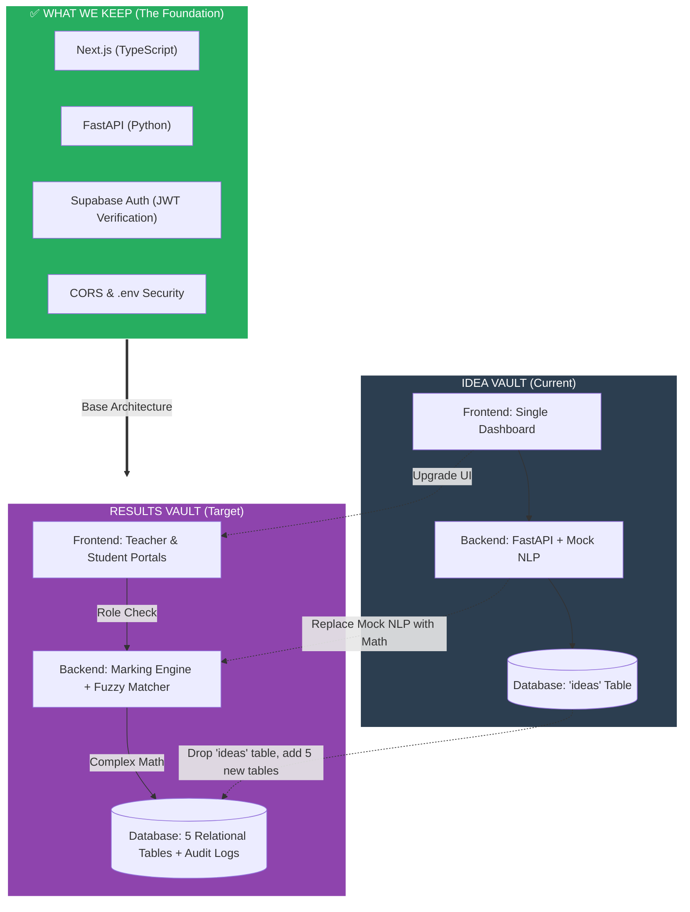
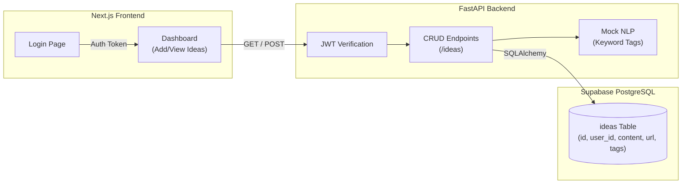
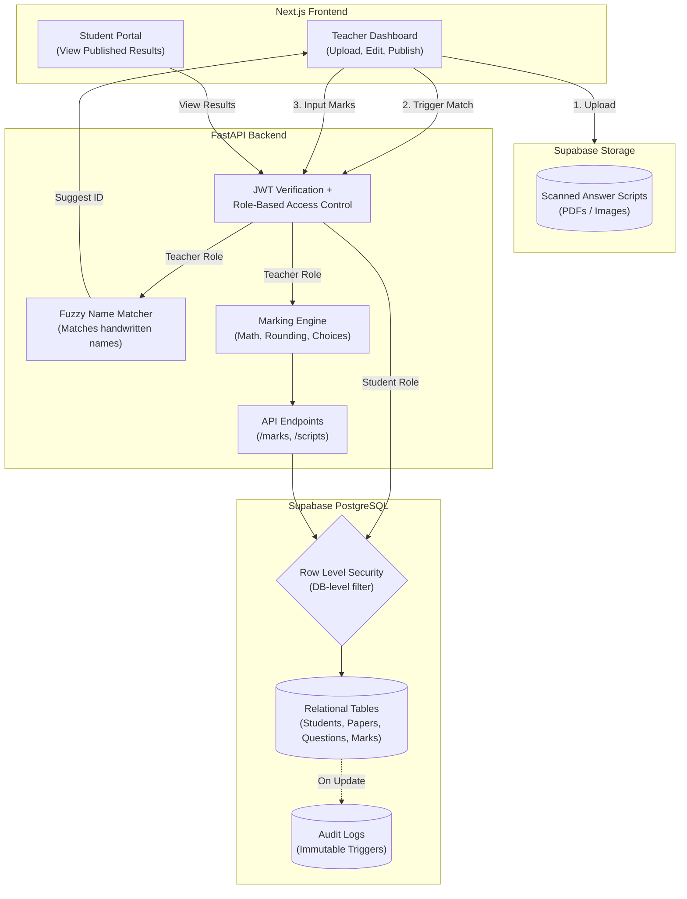
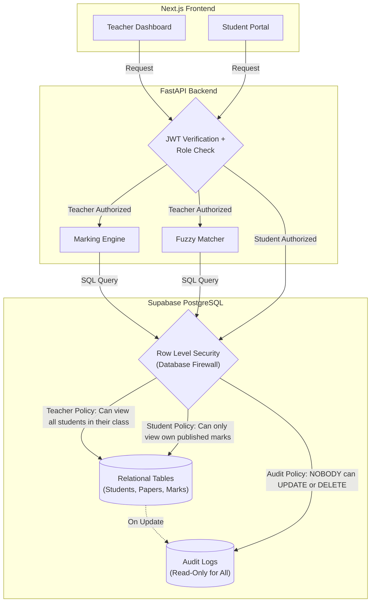

# RESULTS VAULT
So inorder to ensure that we still have the idea-vault app created a feature branch called results-vault
now remember git tracks changes but if we make changes in the db lets say i drop ideas table then its dropped so thts the issue
so for now keep the ideas table in supabase even tho u wont be using it in results-vault

# WHY TRANSFORM IDEA-VAULT TO RESULTS-VAULT 
Here is the exact breakdown of both architectures, followed by a visual "Transformation Diagram" showing exactly what we keep, what we throw away, and what we add.

---

### 🏗️ 1. Idea Vault Architecture (Where you are now)
**The Analogy:** A simple personal diary. 
*   **Frontend:** One single dashboard. You log in, see a form to add an idea, and a list of your ideas.
*   **Backend:** Receives requests, checks your JWT token to ensure you are who you say you are, runs a simple string-matching "Mock NLP" to generate tags, and saves it.
*   **Database:** One single table (`ideas`). If you want an idea, you ask for it. Very simple, linear flow.

### 🏗️ 2. Results Vault Architecture (Where we are going)
**The Analogy:** A highly secure bank.
*   **Frontend:** Two completely different views. A **Teacher Dashboard** (to input marks, see analytics, and publish results) and a **Student Portal** (to view their own published marks).
*   **Backend:** Much heavier. It verifies the JWT, checks if you are a Teacher or Student (Role-Based Access Control), runs complex math (rounding to 0.5, handling "Answer 2 of 4"), and uses a Fuzzy Matcher to guess who a messy handwritten paper belongs to.
*   **Database:** 5 highly relational tables (`students`, `papers`, `questions`, `scripts`, `marks`). It has strict constraints (no duplicate roll numbers in the same section) and an **Immutable Audit Log** (a database trigger that logs every time a mark is changed and prevents anyone from deleting that log).

---

### 🔄 3. The Transformation Diagram

Here is the visual of what stays, what goes, and what is added.

### 🗑️ What We Let Go
1.  **The `ideas` table:** We will drop this from the database.
2.  **Mock NLP:** The `if "app" in text` logic is useless for exam marks.
3.  **Single Dashboard UI:** We are splitting it into a Teacher view and a Student view.

### 📦 What We Keep (Do not rebuild this!)
1.  **JWT Authentication:** The login system and the `jwt.decode()` verification we did yesterday stays exactly the same.
2.  **The connection setup:** `database.py`, `.env` secrets, and CORS middleware.
3.  **The Tech Stack:** Next.js, FastAPI, and Supabase remain the exact same.

### ✨ What We Add
1.  **5 New Tables:** `students`, `papers`, `questions`, `answer_scripts`, `question_marks`.
2.  **RBAC (Role-Based Access Control):** The backend must check if the user is a Teacher or a Student.
3.  **The Marking Engine:** Pure Python math for rounding and choice groups.
4.  **Database Triggers:** A Postgres function that creates an un-deletable audit trail.

---

Here is the detailed architecture for both applications. 

I have broken them down into their specific layers (Frontend, Backend, Database, Security), and at the bottom, you will find the Mermaid diagrams that visually map out the systems.

---

# 🏗️ 1. IDEA VAULT Architecture (Current)

**The Concept:** A simple, single-user diary app. The focus is on basic CRUD (Create, Read, Update, Delete) and identifying the user via a token.

### 1. Frontend (Next.js + TypeScript + Tailwind)
*   **Routing:** Two pages: `/` (Login) and `/dashboard` (The App).
*   **UI:** A single form to add text/URLs, and a list that displays the ideas with colored tag badges.
*   **State:** Uses React `useState` to hold the list of ideas and `useEffect` to fetch them on load.
*   **Auth:** Uses `supabase.auth` to log in and grabs the JWT token to send to the backend.

### 2. Backend (FastAPI + Python)
*   **Routing:** Two endpoints: `GET /ideas` and `POST /ideas`.
*   **Logic:** 
    *   **Mock NLP:** Simple Python string matching (`if "app" in text`) to auto-generate tags.
    *   **Security:** Strict JWT decoding (`jwt.decode`) using the Supabase Secret.
*   **Data handling:** Extracts the user's email from the verified JWT and uses it to filter data.

### 3. Database (Supabase PostgreSQL)
*   **Tables:** Just one table (`ideas`).
*   **Schema:** `id`, `user_id`, `content`, `url`, `tags`.
*   **Relationships:** None. It's a flat table.
*   **Security:** RLS is enabled on the table (checking `auth.email() = user_id`), but the FastAPI backend connects via a master password and filters data in Python.

### 4. Testing
*   **Pytest:** Tests to ensure users can only read their own data and that fake JWT tokens are rejected.

---

# 🏗️ 2. RESULTS VAULT Architecture (Target)

**The Concept:** A high-security, multi-role school examination system. The focus is on relational data, complex math, file storage, and strict authorization.

### 1. Frontend (Next.js + TypeScript)
*   **Routing:** Multiple views based on role.
    *   `/login`
    *   `/teacher` (Upload scripts, review fuzzy matches, input marks, publish results).
    *   `/student` (View published results only).
*   **State:** Complex state for handling file uploads (for scanned scripts) and real-time mark calculations.

### 2. Backend (FastAPI + Python)
*   **Routing:** Multiple endpoints (`/papers`, `/questions`, `/marks`, `/scripts`).
*   **Logic:**
    *   **RBAC (Role-Based Access Control):** Checks if the JWT token belongs to a Teacher or a Student. Students get `403 Forbidden` if they try to hit teacher endpoints.
    *   **Marking Engine:** A pure Python module that handles the complex math (rounding to nearest 0.5, calculating "best 2 of 4" questions, applying grace marks).
    *   **Fuzzy Matcher:** An algorithm (like Levenshtein distance) that tries to match messy handwritten names on scanned scripts to the database of students.
*   **Data handling:** Talks to both the Database (for marks) and Supabase Storage (for PDFs/Images of the answer scripts).

### 3. Database (Supabase PostgreSQL)
*   **Tables:** 5 highly relational tables.
    *   `students` (Constraint: Roll number unique per class+section).
    *   `papers`
    *   `questions` (Supports "choice groups").
    *   `answer_scripts` (Tracks if a paper is Pending, Graded, or Published).
    *   `question_marks` (The specific score for each question).
*   **Audit Logs (Triggers):** A `mark_changes` table. If a teacher changes a mark from 80 to 90, a PostgreSQL trigger automatically logs *who* did it, *when*, and *what* the old/new marks were. This table is immutable (cannot be deleted or updated).

### 4. Storage
*   **Supabase Storage:** A cloud bucket to store the actual images/PDFs of the scanned answer scripts.

### 5. Testing
*   **Pytest:** Tests the Marking Engine math, tests RBAC (proving Student A can't read Student B's marks).
*   **Playwright:** E2E tests that log in as a student and try to access another student's URL.

---

# 📊 The Visual Architecture Diagrams

### 🔹 Idea Vault Architecture Diagram

 

### 🔹 Results Vault Architecture Diagram

# BUT RLS IS ONLY FOR STUDENTS BUT IT SHLD BE FOR TEACHERS AS WELL
**You are 100% right, and this is an excellent catch.** 

In the diagram, I visually routed the Student path straight through RLS, but routed the Teacher path through the API first. That was a poor visual choice on my part. 

**RLS is a database-level firewall. It applies to EVERY SINGLE QUERY that hits the database, regardless of who is asking.** 

Here is the exact breakdown of how RLS works for both roles, and below that, the corrected diagram.

### How RLS applies to Teachers vs. Students
RLS doesn't mean "block everyone." It means "apply the rules based on who is logged in." 

**1. The Student RLS Policy:**
*   **Rule:** `auth.uid() = student_id AND status = 'Published'`
*   **Meaning:** A student can only `SELECT` rows that belong to them, AND they cannot see the row if the teacher hasn't clicked "Publish" yet.

**2. The Teacher RLS Policy:**
*   **Rule:** `auth.jwt() ->> 'role' = 'teacher'` (or a specific school/class ID check).
*   **Meaning:** A teacher can see all students in their assigned classes. But here is the kicker: **Teachers should NOT be allowed to delete the Audit Logs.** RLS would be used to ensure a teacher can `INSERT` into `mark_changes` but cannot `UPDATE` or `DELETE` from it.

### The "Master Password" Nuance (Why we still need RBAC)
Remember our earlier conversation about the "Master Key"? 
Right now, your FastAPI backend connects to Supabase using the `postgres` user. **This user bypasses RLS entirely.** 

So, if a hacker logs in as a Student but tricks FastAPI into running a query without filtering, RLS won't catch it because FastAPI is using the Master Key. 
*   **That is why we have RBAC (Role-Based Access Control) in FastAPI.** The API checks the JWT: *"Are you a teacher? Yes? Okay, you can run this query."*
*   **RLS is the second line of defense.** If a hacker somehow bypasses FastAPI and talks *directly* to Supabase using the frontend anon key, RLS will physically block them from reading other students' data.

---

### The Corrected Diagram

Here is the fixed architecture where **every single request** goes through the API/RBAC layer, and then **every single database query** goes through the RLS firewall.

### Why this architecture is bulletproof:
1.  **Layer 1 (FastAPI RBAC):** Blocks students from hitting teacher endpoints like `POST /marks`.
2.  **Layer 2 (Database RLS):** Even if a student somehow tricks FastAPI into running a query for someone else's marks, RLS checks the student's JWT and says: *"You are not allowed to read this row. I am returning an empty set."*

You are officially thinking like a Senior Backend Engineer by questioning the placement of the security layers. Let's keep this architecture in mind as we build. Are you ready to create the tables?
