# FastAPI Crash Course 

## 1. Topic → Info Table

| # | Topic | Key Info / Explanation |
|---|-------|------------------------|
| 1 | **What is FastAPI** | Modern, fast, high-performance Python web framework for building APIs. Great auto-generated docs (Swagger). Also good for web apps. |
| 2 | **Prerequisites** | Basic Python knowledge; Python ≥ 3.6 installed. |
| 3 | **Installation** | `pip install fastapi` (or `py -m pip install fastapi`, `pip3 install fastapi`). |
| 4 | **Why Uvicorn** | FastAPI is lightweight and does **not** ship a web server (unlike Django). You need an ASGI server → `pip install uvicorn`. |
| 5 | **Project setup** | Create folder + file `myapi.py`, open in VS Code, `cd` into the folder in terminal. Must run uvicorn from that directory. |
| 6 | **Creating the app instance** | `from fastapi import FastAPI` then `app = FastAPI()`. `app` is the instance used to register routes. |
| 7 | **Endpoint (definition)** | One end of a communication channel — practically the **path** in a URL (e.g. `/create-user`). Each endpoint performs an operation. |
| 8 | **HTTP methods** | **GET** = read/return data; **POST** = create new object; **PUT/PATCH** = update existing object; **DELETE** = remove data. |
| 9 | **First route** | `@app.get("/")` decorator + function returning data. FastAPI auto-converts Python dicts → JSON. |
| 10 | **Running the server** | `uvicorn myapi:app --reload` → `file_name:app_instance`. `--reload` auto-restarts on save. |
| 11 | **Auto docs** | Visit `/docs` → Swagger UI. Lists endpoints, methods, function names; "Try it out" lets you test APIs without Postman. |
| 12 | **Path parameter** | Dynamic segment in URL using `{student_id}` in the route and a matching typed function argument (`student_id: int`). |
| 13 | **`Path()` metadata** | Import `Path` from fastapi to add `description`, `gt`, `lt`, `ge`, `le` validation and docs. `None` default catches missing input. |
| 14 | **Query parameter** | Key=value after `?` in URL (e.g. `?name=john`). Detected when a function arg is **not** in the route path. |
| 15 | **Optional query params** | Default `= None` makes it optional; best practice is `Optional[str] = None` via `from typing import Optional`. |
| 16 | **Multiple query params pitfall** | Python disallows a non-default arg after a default arg → `SyntaxError: non-default argument follows default argument`. Fix: put `*,` (keyword-only marker) at the start of the signature. |
| 17 | **Combining path + query** | Same route can take both — path param is in the URL template, query param is just a function argument not in the path. |
| 18 | **Request body** | Data sent by client to create/update an object. Modeled with Pydantic `BaseModel` classes; validated automatically. |
| 19 | **POST method** | `@app.post(...)` + Pydantic model arg = request body. Check for duplicate ID → return error; else store and return created object. |
| 20 | **In-memory storage caveat** | Data lives in a Python dict → lost on server restart. Real apps need a database. |
| 21 | **PUT/PATCH update** | Needs a separate model (`UpdateStudent`) with **all fields Optional** so users can update just one field. |
| 22 | **Partial update guard** | `if student.name is not None:` (etc.) before assigning — prevents overwriting fields with `None`. |
| 23 | **DELETE method** | `@app.delete("/delete-student/{student_id}")` — check existence, then `del students[student_id]`, return success message. |

---

## 2. Complete Flowchart 

```mermaid
flowchart TD
    A["Start - FastAPI Crash Course"] --> B["Install dependencies<br/>pip install fastapi<br/>pip install uvicorn"]
    B --> C["Create project<br/>folder plus myapi.py<br/>cd into folder"]
    C --> D["Create app instance<br/>from fastapi import FastAPI<br/>app = FastAPI"]
    D --> E["Define first GET route<br/>app.get root path"]
    E --> F["Run server<br/>uvicorn myapi app with reload"]
    F --> G["Test in browser<br/>plus open docs Swagger UI"]

    G --> H["PATH PARAMETERS"]
    H --> H1["Route get-student with student_id<br/>arg student_id as int"]
    H1 --> H2["Add Path metadata<br/>description gt lt ge le"]
    H2 --> H3["Test valid id and invalid id<br/>invalid gives validation error"]

    H3 --> I["QUERY PARAMETERS"]
    I --> I1["Route get-by-name<br/>arg name as str<br/>URL uses question mark name equals john"]
    I1 --> I2["Make optional<br/>Optional str equals None"]
    I2 --> I3["Multiple params pitfall<br/>SyntaxError non-default<br/>after default"]
    I3 --> I4["Fix add star to make<br/>params keyword-only"]

    I4 --> J["COMBINE PATH PLUS QUERY"]
    J --> J1["Route get-by-name with student_id<br/>student_id path plus name and test query"]
    J1 --> J2["Verify both show in docs"]

    J2 --> K["POST PLUS REQUEST BODY"]
    K --> K1["Define Pydantic model<br/>class Student BaseModel"]
    K1 --> K2["app.post create-student with id<br/>student as Student model"]
    K2 --> K3{"ID already exists"}
    K3 -->|Yes| K4["Return Error<br/>Student exists"]
    K3 -->|No| K5["Store in dict<br/>return new student"]
    K4 --> L
    K5 --> L

    L["PUT PATCH UPDATE"]
    L --> L1["Create UpdateStudent model<br/>ALL fields Optional"]
    L1 --> L2["app.put update-student with id<br/>student as UpdateStudent"]
    L2 --> L3{"ID exists in dict"}
    L3 -->|No| L4["Return Error<br/>Student does not exist"]
    L3 -->|Yes| L5["Guard each field<br/>if value is not None<br/>then update"]
    L5 --> L6["Return updated student"]
    L4 --> M

    L6 --> M["DELETE"]
    M --> M1["app.delete delete-student with id"]
    M1 --> M2{"ID exists in dict"}
    M2 -->|No| M3["Return Error<br/>Student does not exist"]
    M2 -->|Yes| M4["del students id<br/>return success message"]
    M3 --> N
    M4 --> N

    N["End - Full CRUD in-memory<br/>Data lost on restart<br/>real apps need a DB"]

    style A fill:#4CAF50,color:#ffffff,stroke:#2E7D32,stroke-width:2px
    style N fill:#F44336,color:#ffffff,stroke:#B71C1C,stroke-width:2px
    style H fill:#2196F3,color:#ffffff
    style I fill:#03A9F4,color:#ffffff
    style J fill:#00BCD4,color:#ffffff
    style K fill:#FF9800,color:#ffffff
    style L fill:#FF5722,color:#ffffff
    style M fill:#9C27B0,color:#ffffff
```



---

## 3. All Code From the Video

### 3.1 Installation (terminal)

```bash
pip install fastapi
pip install uvicorn
# run the server
uvicorn myapi:app --reload
```

### 3.2 First API — home route

```python
from fastapi import FastAPI

app = FastAPI()

@app.get("/")
def index():
    return {"name": "First Data"}
```

### 3.3 In-memory "database" (student dict)

```python
students = {
    1: {
        "name": "john",
        "age": 17,
        "year": "year 12"   # called "class" in video, renamed to avoid keyword
    }
}
```

### 3.4 Path parameter — get student by ID

```python
@app.get("/get-student/{student_id}")
def get_student(student_id: int):
    return students[student_id]
```

### 3.5 Path parameter with `Path()` metadata & validation

```python
from fastapi import FastAPI, Path

@app.get("/get-student/{student_id}")
def get_student(
    student_id: int = Path(None, description="The ID of the student you want to view",
                           gt=0, lt=3)
):
    return students[student_id]
```

> `gt=0, lt=3` → only 1 and 2 allowed. Out-of-range gives a validation error in `/docs`.

### 3.6 Query parameter — get by name

```python
@app.get("/get-by-name")
def get_student(*, name: str):
    for student_id in students:
        if students[student_id]["name"] == name:
            return students[student_id]
    return {"Data": "Not found"}
```

### 3.7 Optional query parameter (best practice)

```python
from typing import Optional

@app.get("/get-by-name")
def get_student(*, name: Optional[str] = None, test: int):
    for student_id in students:
        if students[student_id]["name"] == name:
            return students[student_id]
    return {"Data": "Not found"}
```

> The `*,` makes everything after it keyword-only, fixing the "non-default argument follows default argument" error.

### 3.8 Combine path + query parameters

```python
@app.get("/get-by-name/{student_id}")
def get_student(*, student_id: int, name: Optional[str] = None, test: int):
    for student_id in students:
        if students[student_id]["name"] == name:
            return students[student_id]
    return {"Data": "Not found"}
```

> `student_id` is in the route template (path param); `name`/`test` are function-only args (query params).

### 3.9 POST + Request Body — Pydantic models

```python
from fastapi import FastAPI, Path
from typing import Optional
from pydantic import BaseModel

app = FastAPI()

class Student(BaseModel):
    name: str
    age: int
    year: str

class UpdateStudent(BaseModel):
    name: Optional[str] = None
    age: Optional[int] = None
    year: Optional[str] = None
```

### 3.10 POST — create student

```python
@app.post("/create-student/{student_id}")
def create_student(student_id: int, student: Student):
    if student_id in students:
        return {"Error": "Student exists"}
    students[student_id] = student
    return students[student_id]
```

### 3.11 PUT/PATCH — partial update with guards

```python
@app.put("/update-student/{student_id}")
def update_student(student_id: int, student: UpdateStudent):
    if student_id not in students:
        return {"Error": "Student does not exist"}

    if student.name is not None:
        students[student_id].name = student.name

    if student.age is not None:
        students[student_id].age = student.age

    if student.year is not None:
        students[student_id].year = student.year

    return students[student_id]
```

### 3.12 DELETE — remove student

```python
@app.delete("/delete-student/{student_id}")
def delete_student(student_id: int):
    if student_id not in students:
        return {"Error": "Student does not exist"}
    del students[student_id]
    return {"Message": "Student deleted successfully"}
```

---

## 4. Key Points
1. **FastAPI ≠ full-stack framework** — it's the app layer only; uvicorn is the ASGI server.
2. **Decorators = routing** — `@app.<method>("/path")` binds a function to an HTTP verb + URL.
3. **Type hints are the API contract** — `student_id: int` gives you validation + auto-docs for free.
4. **Path vs query in one sentence** — *path param lives in the URL template; query param is any extra typed function argument.*
5. **Pydantic models = request body schema** — validation, serialization, and Swagger docs from one class.
6. **Optional-everything pattern for PATCH** — partial updates need a separate model + `is not None` guards.
7. **`*,` in signatures** — Python's keyword-only marker solves "optional before required".
8. **This demo is in-memory** — restart wipes data; production needs a real DB (the video explicitly calls this out).
9. **`/docs` is a superpower** — test endpoints with zero extra tooling (no Postman needed).

---
