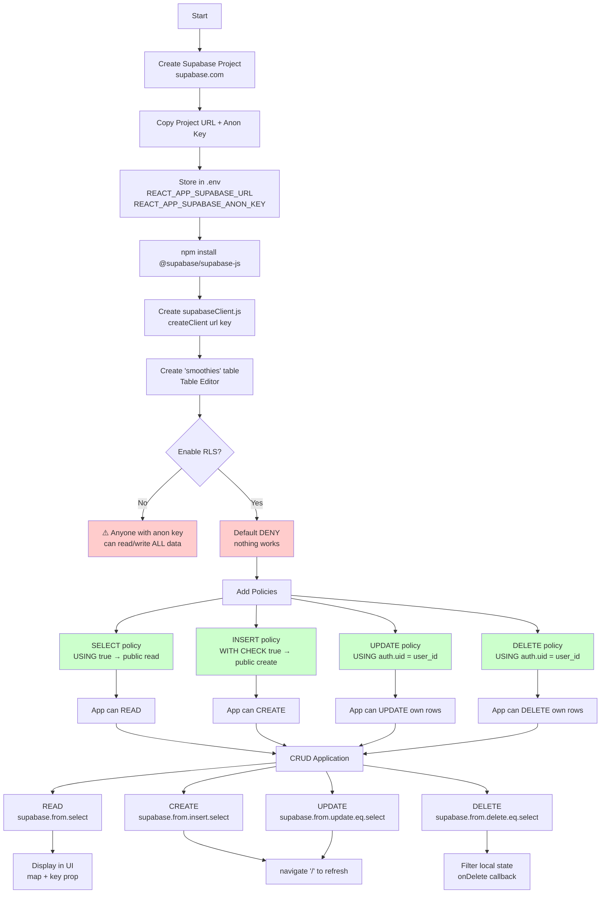
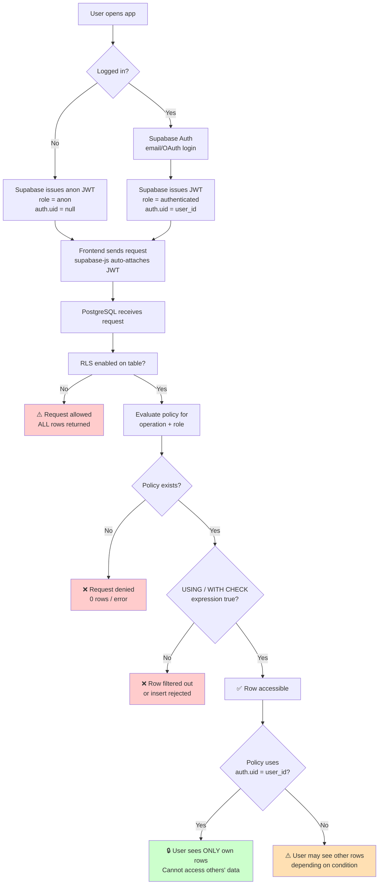

# Supabase  Notes — Database & Authentication


> Covers: What is Supabase, Connecting, Fetching Data, Adding Records, Fetching Single Records, Updating, Deleting, Updating Local State, Ordering, RLS & Policies

---

## 1. What is Supabase?

Supabase is a **Backend-as-a-Service (BaaS)** — it provides backend services you connect to from your frontend:

- **Database** (PostgreSQL)
- **Authentication**
- **Storage**
- **Edge Functions**
- **Realtime**

### Supabase vs Firebase

| Feature | Supabase | Firebase |
|---|---|---|
| Database type | PostgreSQL (SQL, rows/columns) | NoSQL (documents) |
| Open source | ✅ Yes — full autonomy | ❌ No — vendor lock-in |
| Self-hostable | ✅ Yes | ❌ No |
| API style | SQL terminology (`from`, `select`, `eq`) | Document-based |
| Marketed as | Firebase alternative | — |

> Both are good tools — choice depends on project needs. Supabase gives you more control because it's built on open-source tech.

**Course project:** "Super Smoothies" — a CRUD app (Create, Read, Update, Delete) built with React + Supabase.

---

## 2. Connecting to Supabase

### Step 1: Create a Supabase Project
1. Go to [supabase.com](https://supabase.com) → Sign in with GitHub
2. Create a new organization (if prompted)
3. Click **New Project** → choose org → name it (e.g., `super-smoothies`) → set database password → choose region → **Create new project**

### Step 2: Grab API Credentials
From project dashboard → **Settings → API**, copy:
- **Project URL**
- **Public anon key**

### Step 3: Store in Environment Variables
Create `.env` in project root:

```env
REACT_APP_SUPABASE_URL=your_project_url
REACT_APP_SUPABASE_ANON_KEY=your_anon_key
```

> ⚠️ All React env variables **must** be prefixed with `REACT_APP_`

### Step 4: Install Supabase Client

```bash
npm install @supabase/supabase-js
```

### Step 5: Create the Supabase Client

**`src/config/supabaseClient.js`**

```js
import { createClient } from '@supabase/supabase-js'

const supabaseUrl = process.env.REACT_APP_SUPABASE_URL
const supabaseKey = process.env.REACT_APP_SUPABASE_ANON_KEY

const supabase = createClient(supabaseUrl, supabaseKey)

export default supabase
```

> ⚠️ Restart dev server (`Ctrl+C` → `npm start`) after installing new packages.

---

## 3. Database Tables (Creating the `smoothies` Table)

### Table Editor Setup
Go to **Table Editor** → **New Table**:

| Column | Type | Notes |
|---|---|---|
| `id` | int8 | Primary key, auto-generated |
| `created_at` | timestamp | Auto-generated |
| `title` | text | |
| `method` | text | |
| `rating` | int4 | |

> Leave **RLS** and **Realtime** unchecked for now (covered later).

### Adding Rows
Use **Insert Row** in Table Editor, or insert via the app (see §5).

---

## 4. Fetching Data (Read)

**`src/pages/Home.js`**

```js
import { useEffect, useState } from 'react'
import supabase from '../config/supabaseClient'

const Home = () => {
  const [fetchError, setFetchError] = useState(null)
  const [smoothies, setSmoothies] = useState(null)

  useEffect(() => {
    const fetchSmoothies = async () => {
      const { data, error } = await supabase
        .from('smoothies')
        .select()

      if (error) {
        setFetchError('Could not fetch the smoothies')
        setSmoothies(null)
        console.log(error)
      }
      if (data) {
        setSmoothies(data)
        setFetchError(null)
      }
    }
    fetchSmoothies()
  }, [])

  return (
    <div className="page home">
      {fetchError && <p>{fetchError}</p>}
      {smoothies && (
        <div className="smoothies">
          {smoothies.map(smoothie => (
            <SmoothieCard key={smoothie.id} smoothie={smoothie} />
          ))}
        </div>
      )}
    </div>
  )
}
```

> 💡 Always pass a unique `key` prop when mapping (e.g., `smoothie.id`) to avoid React warnings.

---

## 5. Adding Records (Create)

**`src/pages/Create.js`**

```js
const handleSubmit = async (e) => {
  e.preventDefault()

  if (!title || !method || !rating) {
    setFormError('Please fill in all the fields correctly.')
    return
  }

  const { data, error } = await supabase
    .from('smoothies')
    .insert([{ title, method, rating }])
    .select()

  if (error) {
    setFormError('Could not insert the smoothie')
    console.log(error)
  }
  if (data) {
    setFormError(null)
    navigate('/')
  }
}
```

> 💡 **Version 1** returns the inserted row by default. **Version 2** requires `.select()` appended to get the row back.

### Form Template

```jsx
<form onSubmit={handleSubmit}>
  <label htmlFor="title">Title:</label>
  <input
    id="title"
    type="text"
    value={title}
    onChange={(e) => setTitle(e.target.value)}
  />

  <label htmlFor="method">Method:</label>
  <textarea
    id="method"
    value={method}
    onChange={(e) => setMethod(e.target.value)}
  />

  <label htmlFor="rating">Rating:</label>
  <input
    id="rating"
    type="number"
    value={rating}
    onChange={(e) => setRating(e.target.value)}
  />

  <button>Create Smoothie</button>
  {formError && <p className="error">{formError}</p>}
</form>
```

---

## 6. Fetching a Single Record (for Update Form)

**`src/pages/Update.js`**

```js
import { useParams, useNavigate } from 'react-router-dom'
import { useEffect, useState } from 'react'
import supabase from '../config/supabaseClient'

const Update = () => {
  const { id } = useParams()
  const navigate = useNavigate()

  const [title, setTitle] = useState('')
  const [method, setMethod] = useState('')
  const [rating, setRating] = useState('')
  const [formError, setFormError] = useState(null)

  useEffect(() => {
    const fetchSmoothie = async () => {
      const { data, error } = await supabase
        .from('smoothies')
        .select()
        .eq('id', id)
        .single()

      if (error) {
        navigate('/', { replace: true })
      }
      if (data) {
        setTitle(data.title)
        setMethod(data.method)
        setRating(data.rating)
        console.log(data)
      }
    }
    fetchSmoothie()
  }, [id, navigate])
}
```

> 💡 `.eq('column', value)` = "where column equals value"
> 💡 `.single()` returns a single object (not an array)
> 💡 `navigate('/', { replace: true })` redirects without adding to history

---

## 7. Updating Records

```js
const handleSubmit = async (e) => {
  e.preventDefault()

  if (!title || !method || !rating) {
    setFormError('Please fill in all the fields correctly.')
    return
  }

  const { data, error } = await supabase
    .from('smoothies')
    .update({ title, method, rating })
    .eq('id', id)
    .select()

  if (error) {
    setFormError('Could not update the smoothie')
    console.log(error)
  }
  if (data) {
    setFormError(null)
    navigate('/')
  }
}
```

> 💡 Version 2 needs `.select()` at the end if you want the updated row back.

---

## 8. Deleting Records

**`src/components/SmoothieCard.js`**

```js
const handleDelete = async () => {
  const { data, error } = await supabase
    .from('smoothies')
    .delete()
    .eq('id', smoothie.id)
    .select()

  if (error) {
    console.log(error)
  }
  if (data) {
    console.log(data)
    onDelete(smoothie.id)  // notify parent to update local state
  }
}
```

> 💡 Version 2: add `.select()` to get the deleted record back.

---

## 9. Keeping Local State in Sync (After Delete)

**`src/pages/Home.js`**

```js
const handleDelete = (id) => {
  setSmoothies((prevSmoothies) => {
    return prevSmoothies.filter((smoothie) => smoothie.id !== id)
  })
}

// Pass down as prop:
<SmoothieCard
  key={smoothie.id}
  smoothie={smoothie}
  onDelete={handleDelete}
/>
```

> 💡 Without this, the record is deleted from the DB but still shows in the UI until refresh.
> 💡 Pattern: `setState(prev => ...)` — use the previous value to compute the new one.

---

## 10. Ordering Data

**`src/pages/Home.js`**

```js
const [orderBy, setOrderBy] = useState('created_at')

// In fetch:
const { data, error } = await supabase
  .from('smoothies')
  .select()
  .order(orderBy, { ascending: false })

// Add orderBy to useEffect dependency array:
useEffect(() => { ... }, [orderBy])
```

### Order By Buttons

```jsx
<div className="order-by">
  <p>Order by:</p>
  <button onClick={() => setOrderBy('created_at')}>Time Created</button>
  <button onClick={() => setOrderBy('title')}>Title</button>
  <button onClick={() => setOrderBy('rating')}>Rating</button>
  <p>Currently: {orderBy}</p>
</div>
```

> 💡 `orderBy` must match the **actual column name** in the table.
> 💡 Adding `orderBy` to the `useEffect` dependency array triggers a re-fetch when it changes.

---

## 11. Row Level Security (RLS) & Policies

### Why RLS Exists

By default, **anyone with the public anon key can read AND write to your database**. Since that key is shipped in your frontend bundle, it is **public**. Without RLS:

- Any visitor can read all your data
- Any visitor can create/update/delete rows
- Users could potentially access **each other's data**

RLS is Supabase's way to **enforce access control at the database level**, independent of your frontend code. It's the **only** place you can truly protect your data.

> 🔑 **Key concept:** RLS is the database-level equivalent of Firebase Firestore Rules. Frontend checks can be bypassed; RLS cannot.

### Enabling RLS

1. Go to **Table Editor** → select `smoothies`
2. Click **RLS not enabled** (top right) → **Enable RLS** → **Confirm**

> ⚠️ Enabling RLS with **no policies** = **default deny**. Nothing can read or write — the app breaks until you add policies.

### Policies = Security Rules

A policy describes **who** can perform **what operation** on **which rows**.

**Policy anatomy:**
- **Name** — descriptive label
- **Operation** — `SELECT`, `INSERT`, `UPDATE`, `DELETE`, or `ALL`
- **Role** — `anon`, `authenticated`, `service_role`, or `public`
- **USING expression** — condition for existing rows (SELECT/UPDATE/DELETE)
- **WITH CHECK expression** — condition for new rows (INSERT/UPDATE)

### Example Policies (from the tutorial)

| Policy Name | Operation | Role | Condition |
|---|---|---|---|
| Enable read access for all | SELECT | public | `true` |
| Allow all users to create smoothies | INSERT | public | `true` |
| *(Not created)* | UPDATE | — | Denied by default |
| *(Not created)* | DELETE | — | Denied by default |

> 💡 Use **"Get started quickly"** templates for common patterns, or **"Full customization"** for granular control.

### Tutorial Outcome

After applying the two policies:
- ✅ Anyone can **read** all smoothies (home page works)
- ✅ Anyone can **create** smoothies
- ❌ **Update** requests fail (no policy)
- ❌ **Delete** requests fail (no policy — local state updates but DB doesn't, so it reappears on refresh)

### Why RLS Prevents Access to Other Users' Data

This is the core security benefit. In a real app, you'd write policies like:

```sql
-- Users can only read their OWN rows
CREATE POLICY "Users can view own data"
ON profiles FOR SELECT
USING (auth.uid() = user_id);

-- Users can only update their OWN rows
CREATE POLICY "Users can update own data"
ON profiles FOR UPDATE
USING (auth.uid() = user_id)
WITH CHECK (auth.uid() = user_id);
```

- `auth.uid()` returns the authenticated user's ID from the JWT
- `anon` role = not logged in → `auth.uid()` is null → can't access user-specific rows
- `authenticated` role = logged in → `auth.uid()` matches their ID → can access only their rows
- **Without RLS**, any authenticated user could query `?user_id=someone-else` and read their data
- **With RLS**, the database itself rejects rows that don't match `auth.uid() = user_id`, regardless of what the frontend requests

> 🔒 **Bottom line:** RLS is not optional. It's the boundary between "anyone can read everything" and "each user sees only their own data." Always enable RLS on every table in production.

### Roles in Supabase

| Role | Description |
|---|---|
| `anon` | Unauthenticated users (no JWT) |
| `authenticated` | Logged-in users (valid JWT) |
| `service_role` | Server-side only — **bypasses RLS** (never expose this key) |
| `public` | Both `anon` and `authenticated` |

### RLS Best Practices

- ✅ **Enable RLS on every table** in production
- ✅ **Default deny** — add policies only for what's needed
- ✅ **Use `auth.uid()`** in policies for per-user data isolation
- ✅ **Separate policies per operation** (SELECT / INSERT / UPDATE / DELETE) for fine-grained control
- ❌ **Never expose `service_role` key** in frontend code
- ❌ **Never rely on frontend-only checks** — they can be bypassed
- ⚠️ **Test policies** by trying operations as `anon` vs `authenticated`

---

## 12. Authentication (Preview — Advanced Topic)

The beginner series touches on RLS but **does not cover authentication in depth**. Supabase Auth provides:

- **Email/password** signup & login
- **OAuth** (GitHub, Google, etc.)
- **Magic links**
- **JWT-based sessions** — the client library automatically attaches the user's JWT to requests

### How Auth Connects to RLS

```
User logs in → Supabase issues JWT (contains user ID)
    ↓
Frontend makes request with JWT (supabase-js does this automatically)
    ↓
PostgreSQL receives request → RLS policies evaluate
    ↓
auth.uid() = user's ID from JWT
    ↓
Policy: USING (auth.uid() = user_id)
    ↓
✅ Rows matching user_id returned  |  ❌ Other rows filtered out
```

> 🔑 **This is the mechanism** that prevents users from accessing each other's data. The combination of **Auth (JWT) + RLS (`auth.uid()`)** is what makes Supabase secure for multi-user apps.

### Example: Per-User Data Isolation

```sql
-- Table: user_smoothies (has user_id column)
ALTER TABLE user_smoothies ENABLE ROW LEVEL SECURITY;

-- Read: only own rows
CREATE POLICY "read own" ON user_smoothies
FOR SELECT USING (auth.uid() = user_id);

-- Insert: can only insert rows belonging to self
CREATE POLICY "insert own" ON user_smoothies
FOR INSERT WITH CHECK (auth.uid() = user_id);

-- Update: only own rows
CREATE POLICY "update own" ON user_smoothies
FOR UPDATE USING (auth.uid() = user_id)
WITH CHECK (auth.uid() = user_id);

-- Delete: only own rows
CREATE POLICY "delete own" ON user_smoothies
FOR DELETE USING (auth.uid() = user_id);
```

Even if a malicious user crafts a request with `?user_id=victim-id`, the database **rejects** it because `auth.uid()` won't match.

---

## 13. Key Supabase Client Methods Cheat Sheet

| Method | Purpose | Example |
|---|---|---|
| `.from('table')` | Target a table | `.from('smoothies')` |
| `.select()` | Fetch rows (all columns) | `.select()` |
| `.select('col1, col2')` | Fetch specific columns | `.select('title, rating')` |
| `.insert([{...}])` | Insert row(s) — **always an array** | `.insert([{ title: 'X' }])` |
| `.update({...})` | Update row(s) | `.update({ title: 'Y' })` |
| `.delete()` | Delete row(s) | `.delete()` |
| `.eq('col', val)` | Where column = value | `.eq('id', 5)` |
| `.single()` | Return one object, not array | `.single()` |
| `.order('col', { ascending: false })` | Sort results | `.order('rating', { ascending: false })` |
| `.limit(n)` | Limit results | `.limit(10)` |

---

## 14. Common Pitfalls

| Pitfall | Fix |
|---|---|
| Env vars undefined | Prefix with `REACT_APP_`, restart dev server |
| React key warning | Add `key={item.id}` when mapping |
| Update returns no data (v2) | Append `.select()` |
| Delete doesn't update UI | Call parent's `onDelete` to filter local state |
| RLS breaks everything | Add policies after enabling RLS (default deny) |
| Misspelled table name | 404 error — check table name |
| Forgot `await` | Add `await` before `supabase.from(...)` |

---

## 15. Complete Flowchart — CRUD + Auth + RLS



---

## 16. Authentication + RLS Flowchart (Per-User Data Isolation)



---

## 17. Quick Reference — File Structure

```
super-smoothies/
├── .env                          # Supabase URL + anon key
├── package.json
└── src/
    ├── config/
    │   └── supabaseClient.js     # createClient()
    ├── components/
    │   └── SmoothieCard.js       # edit + delete buttons
    ├── pages/
    │   ├── Home.js               # fetch all, order, delete
    │   ├── Create.js             # insert new
    │   └── Update.js             # fetch single, update
    ├── App.js                    # routes
    ├── index.js
    └── index.css
```

---

## 18. Summary — Why RLS Matters

| Without RLS | With RLS + Policies |
|---|---|
| Anyone with anon key reads all data | Only policy-approved reads |
| Anyone can insert/update/delete | Only policy-approved writes |
| Users can access each other's data | `auth.uid() = user_id` isolates rows |
| Security relies on frontend code | Security enforced at DB level |
| Data breach waiting to happen | Production-ready security model |

> **The one-sentence takeaway:** Supabase gives you a powerful backend out of the box, but **RLS + policies + `auth.uid()`** are what turn it from a shared public database into a secure multi-user application where each user can only touch their own data.

---
