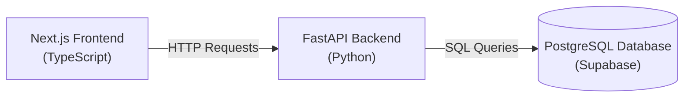
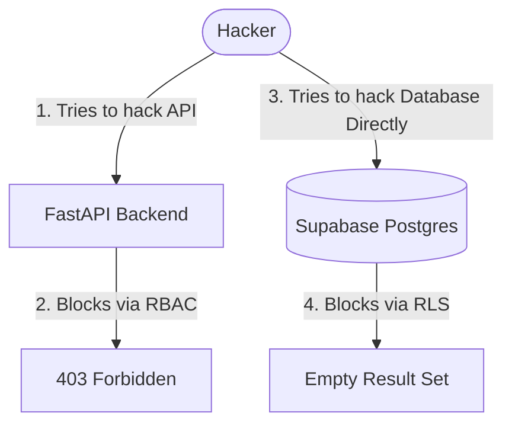
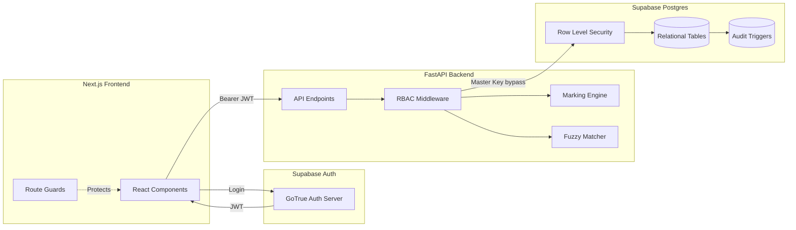
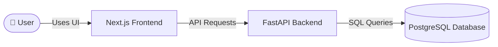
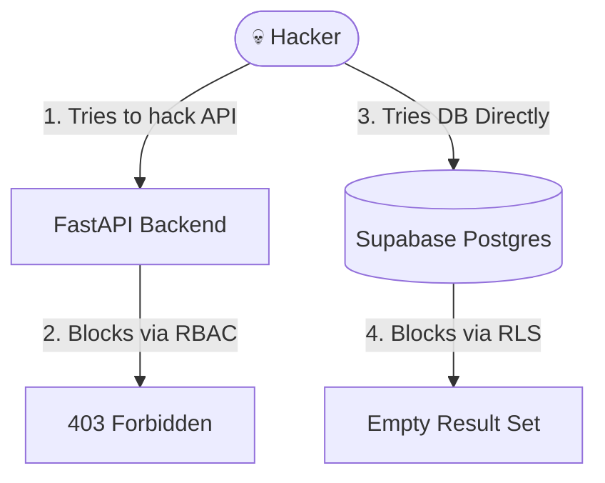

Imagine you are building a super-secure digital report card system for your school. Let's call it the **Results Vault**. 

Right now, teachers have to hand out paper report cards. If a teacher makes a mistake, a kid might get an 80 instead of a 90. And if a hacker gets into the school’s computer system, they could change everyone’s grades!

We built an app to fix all of that. Let me explain how it works, step-by-step, like we are building a spaceship.

---

### 🏗️ Part 1: The Three Main Rooms (The Architecture)

Our app has three main rooms that work together:

1.  **The Frontend (Next.js):** This is the video game menu. It’s what you see on your screen. It has buttons you click and tables you look at. There is a "Teacher Dashboard" and a "Student Portal".
2.  **The Backend (FastAPI):** This is the Brain. When you click a button on the menu, the Backend does the thinking. It checks if you are allowed to do what you're trying to do, does the math, and decides what to send back.
3.  **The Database (Supabase/PostgreSQL):** This is the giant, unbreakable filing cabinet. It holds all the numbers, names, and grades. It never forgets anything, even if you turn the computer off.

---

### 🎟️ Part 2: The Amusement Park Wristband (Authentication)

When you go to an amusement park, you get a wristband. If you don't have one, you can't get on the rides. 

In our app, when you type in your email and password, the app gives you a digital wristband called a **JWT (JSON Web Token)**. 

*   **The Problem:** Hackers try to make fake wristbands. They write "I am a Teacher" on a piece of paper and try to show it to the app.
*   **The Code Fix:** In our Backend code (`main.py`), we wrote a security check. It looks at the wristband and checks a secret hologram on it. 
    ```python
    payload = jwt.decode(token, signing_key.key, algorithms=["ES256"])
    ```
    If the hologram is fake, the app says, "Access Denied!" and kicks the hacker out.

---

### 🧮 Part 3: The Genius Math Teacher (The Marking Engine)

Sometimes exams have a rule: *"Answer any 2 of the 4 questions."* If a student answers all 4, the computer needs to pick the best 2. 

We built a special math machine called the `Marking Engine` to handle this.

*   **The Problem:** Computers are actually really bad at decimals! If you tell a computer to round `2.25`, it might get confused and turn it into `2.2`. If we mess up a student's grade by a tiny decimal, they might fail the class!
*   **The Code Fix:** We used a special Python tool called `Decimal` to make the math perfect. We also told the engine to always round up (so `2.25` becomes `2.5`). 
    ```python
    total = total * Decimal("2")
    total = total.quantize(Decimal("1"), rounding=ROUND_HALF_UP)
    total = total / Decimal("2")
    ```
    This code looks crazy, but it's just a math trick to force the computer to be a perfect math teacher.

---

### 🕵️‍♂️ Part 4: The Handwriting Detective (The Fuzzy Matcher)

When teachers scan paper exams, the handwriting is messy. A kid named "Adithya Bandili" might write "B-Aditya". 

We built a "Detective" algorithm to read the messy names. 

*   **The Problem:** What if there are two kids named Aditya? If the computer guesses wrong, it gives Aditya Singh's grade to Adithya Bandili. That is a disaster!
*   **The Code Fix:** We made a strict rule: **The computer can only guess if TWO things match perfectly.** 
    1. Does the spelling of the name look similar? (AND)
    2. Does the roll number match?
    If it’s not 100% sure, the computer says, *"I don't know who this is"* and lets the teacher fix it manually. It is better to leave a paper blank than to guess wrong.

---

### 🛡️ Part 5: The Laser Grid Security (RBAC & RLS)

This is the coolest part of the app. How do we stop a smart hacker from changing their own grades?

We used two layers of security:

1.  **RBAC (Role-Based Access Control):** This is the front door bouncer. If a student tries to send a message to the "Publish Grades" button, the Backend checks the database and says, *"Wait, you are a student! You aren't allowed to touch the teacher's controls!"* and blocks them.
2.  **RLS (Row Level Security):** This is the laser grid inside the filing cabinet. Even if a hacker somehow sneaks past the front door, the Database has its own rules. The Database itself checks your wristband and says, *"I see you are Student 1. You are trying to look at Student 2's report card. ZAP! Access Denied!"*

---

### 🤖 Part 6: The Robot Hacker (Automated Testing)

How do we know the app actually works before we give it to the school? We hire a robot to try and hack it.

We wrote **Playwright tests**. We taught a robot to open a web browser, log in as a student, and then change the URL from `/results/1` to `/results/2` to try and steal a friend's grade. 

```typescript
  // The robot types the URL
  await page.goto('http://localhost:3000/results/2');
  
  // The robot checks if the app blocked it
  await expect(page.locator('text=You are not allowed to view this result')).toBeVisible();
```

If the robot sees the red "Access Denied" error, we know our security is perfect. 

---

### 🎉 Summary: What did we actually build?

We built a system where:
1. Teachers can log in and see all the students.
2. The computer does the complex math without mistakes.
3. The computer tries its best to read messy handwriting, but knows when to ask for help.
4. A hacker cannot hack the system because there are two layers of security (Backend + Database).
5. A robot constantly tests it to make sure nobody can steal grades.

You just built a real-life, professional software application!

# TAKE-2
Alright, let's break this down. You’re a 20-year-old B.Tech student. You know how to code a basic "Hello World" and maybe built a CRUD app for a mini-project. 

But here’s the thing: **College mini-projects are usually toy apps.** They break if 10 people log in at once. They have zero security. If I change the URL, I can see your data.

We just built the **Results Vault**—a production-grade, secure grading system. It’s the kind of system a real EdTech company would use. Let me explain it from the ground up, like we're looking at the system design whiteboard.

---

### 1. The High-Level Stack (The Architecture)
We used a modern 3-tier architecture. 
*   **Frontend:** Next.js (React + TypeScript). 
*   **Backend:** FastAPI (Python).
*   **Database:** Supabase (PostgreSQL).

Why this stack? Next.js gives us a snappy UI. FastAPI is blazing fast for handling API requests. And PostgreSQL is a heavy-duty relational database that can handle millions of rows.



---

### 2. The Database & Alembic (The Foundation)
Bro, in real companies, you **never** create tables by clicking buttons in pgAdmin. You write **migrations**. We used a tool called **Alembic**. It tracks changes to your database schema just like Git tracks changes to your code.

We designed a relational schema. The most critical business logic here is the **Unique Constraint**:
> *A roll number must be unique within a class and section.*

If you try to insert two students with Roll No. 3 in "10-A", the database will physically reject the query.

```sql
CONSTRAINT unique_roll_per_section UNIQUE (class, section, roll_number)
```

---

### 3. The Core Logic (The Python Modules)
We built two pure Python modules to handle the heavy lifting.

**A. The Marking Engine (`marking_engine.py`)**
This handles the math. Here’s a classic B.Tech interview question: *"Why is `float` bad for money and grades?"* Because floating-point math is imprecise. 
```python
print(0.1 + 0.2) # Outputs 0.30000000000000004
```
If a student scores a 89.95, a float might round it down, causing them to fail. We used Python's `Decimal` module and `ROUND_HALF_UP` to ensure mathematical perfection. We also handled edge cases like the "Answer 2 of 4" logic (sorting by raw marks, not percentage).

**B. The Fuzzy Matcher (`fuzzy_matcher.py`)**
Teachers scan physical answer sheets. Handwriting is messy (e.g., "B-Aditya" instead of "Adithya Bandili"). We used the `difflib` library to calculate string similarity. 
*The rule:* The system only auto-links a paper if the Name Similarity is > 80% **AND** the Roll Number matches exactly. If it's not sure, it leaves it "Unlinked" for the teacher to review. It's better to fail safely than to link a paper to the wrong Aditya.

---

### 4. Security Part 1: JWT & RBAC (The Big Boss)
This is where we go from "college project" to "enterprise software."

When you log in, Supabase gives you a **JWT (JSON Web Token)**. It's a Base64-encoded string that acts as your ID card. 
*   **The Beginner Mistake:** Sending `user_id: 5` in the API request body. A hacker can just change it to `user_id: 6` using Postman. We removed `user_id` from the body entirely.
*   **The Fix:** The backend extracts the user ID directly from the cryptographically signed JWT. 

We also implemented **RBAC (Role-Based Access Control)**. The backend checks the database: *"Is this user in the `teachers` table?"* If a student tries to hit the `/publish` endpoint, they get a `403 Forbidden`.

---

### 5. Security Part 2: Row Level Security (RLS) & The Master Key
Here’s a concept most B.Tech students miss: **Defense in Depth**.

Your FastAPI backend connects to Supabase using the "Master Key" (the database password). Because of this, **FastAPI bypasses RLS entirely.**

So, why did we write RLS policies in Supabase?
*   **Layer 1:** FastAPI filters the data in Python (`db.query(Student).filter(...)`).
*   **Layer 2:** If a hacker finds your Supabase URL and Anon Key, they can bypass FastAPI and talk directly to the database. But when they do, the Database's RLS kicks in: *"I see you are Student 1, but you are trying to read Student 2's marks. Denied."*



---

### 6. Immutable Audit Logs (Postgres Triggers)
What if a teacher changes a mark from 90 to 30 to fail a student? 

If you use Python to log this, a hacker could just delete the log. We used **Postgres Triggers**. 
Every time a row in `question_marks` is updated, a trigger fires on the database level and writes to a `mark_changes` table. 

We then added a second trigger that says:
```sql
IF TG_OP = 'DELETE' THEN
    RAISE EXCEPTION 'Audit logs are immutable!';
END IF;
```
Now, even the database admin can't delete the log. It is cryptographically and structurally immutable.

---

### 7. Quality Assurance (The Testing Pyramid)
You don't just `console.log` to test. We built a 3-tier testing architecture:

1.  **Unit Tests (Pytest):** We wrote 30+ parametrized tests for the Math Engine.
2.  **Property-Based Testing (Hypothesis):** Instead of testing specific numbers, we gave the test a rule: *"No matter what random float you generate, the total mark must always be between 0 and the max."*
3.  **E2E Tests (Playwright):** This is the coolest part. We wrote a script that opens a real Chromium browser, logs in as a student, and tries to hack the URL from `/results/1` to `/results/2`. If the browser sees the "Access Denied" screen, the test passes.

---

### The B.Tech Takeaway
If you put this on your resume, you are not saying *"I built a CRUD app"*. You are saying:
> *"I built a secure multi-tenant architecture with Alembic migrations, JWT verification, Row Level Security, and immutable database triggers, tested via Pytest and Playwright."*

Here is the technical deep-dive. You are a Software Engineer, so we're going to skip the analogies and talk about system design, trade-offs, security vectors, and architectural patterns. 

We are going to look at the **Results Vault** from the database layer up to the presentation layer, focusing on why specific technical decisions were made.

---

### 1. System Architecture (The High Level)
The app uses a decoupled 3-tier architecture with a shared identity provider. 

*   **Client:** Next.js (App Router) with TypeScript. 
*   **API:** FastAPI (Python 3.13) running on Uvicorn.
*   **DB:** Supabase (Managed PostgreSQL) + Supabase Auth.



---

### 2. The Database Layer (Data Integrity)
As engineers, we know that **application code is unreliable**. The DB must enforce truth.

*   **Relational Schema:** 5 tables (`students`, `papers`, `questions`, `answer_scripts`, `question_marks`). We normalized the data. We don't store a student's name on every mark row; we join on `student_id`.
*   **Composite Constraint:** 
    ```sql
    CONSTRAINT unique_roll_per_section UNIQUE (class, section, roll_number)
    ```
    This prevents data corruption at the engine level. Two students in 10-A cannot both be roll number 3.
*   **Immutable Audit Logs:** We used a Postgres `BEFORE UPDATE OR DELETE` trigger.
    ```sql
    CREATE TRIGGER prevent_audit_changes
    BEFORE UPDATE OR DELETE ON mark_changes
    FOR EACH ROW EXECUTE FUNCTION prevent_audit_changes();
    ```
    The function raises an exception. This ensures that even if a rogue admin connects to the DB directly, the audit trail is legally sound and cryptographically protected by the DB engine itself.

---

### 3. The Backend Layer (Business Logic)
We kept the FastAPI routes thin and extracted the pure logic into isolated modules.

**A. The Marking Engine (`marking_engine.py`)**
*   **The Float Trap:** We bypassed standard Python `float` because of IEEE 754 floating-point precision issues. We used `Decimal`.
*   **Rounding Strategy:** Python's default `round()` uses "Banker's Rounding" (rounds `0.5` to the nearest even number). We forced `ROUND_HALF_UP` because it's a grading system (students should get the extra 0.5).
*   **Algorithmic Choice:** For "Answer 2 of 4", we group by `choice_group`, sort descending by `marks_obtained`, and slice `[:2]`. We explicitly sort by *raw marks*, not percentage, to avoid edge cases where a student gets fewer raw marks but a higher percentage on an easier question.

**B. The Fuzzy Matcher (`fuzzy_matcher.py`)**
*   We used `difflib.SequenceMatcher` to calculate the ratio between the OCR string and the DB string.
*   **The 2-Factor Rule:** We strictly require `Name Similarity > 0.8` AND `Roll Number == Exact Match`. 
*   **Trade-off:** We chose to bias the algorithm towards **False Negatives** (leaving papers unlinked) rather than **False Positives** (linking a paper to the wrong student). A False Positive in EdTech is a catastrophic privacy breach.

---

### 4. The Security Architecture (Defense in Depth)
This is where the system gets interesting. We had to solve the **Master Key Problem**.

FastAPI connects to Postgres using the `postgres` superuser (the connection string). **This bypasses RLS entirely.** Therefore, we have a dual-layer security model:

1.  **Layer 1: Application RBAC (FastAPI)**
    *   We verify the JWT using `PyJWKClient`. Supabase migrated their JWT signing to asymmetric keys (ES256). We fetch their JWKS (JSON Web Key Set) to cryptographically verify the signature, audience (`aud`), and expiration.
    *   We implemented RBAC by querying the `teachers` table. If a student hits `/publish`, we return `403 Forbidden`.
    *   We removed `user_id` from the Pydantic request models. The server solely extracts the user identity from the JWT, preventing IDOR (Insecure Direct Object Reference) attacks.

2.  **Layer 2: Database RLS (Supabase)**
    *   If a client uses the public Anon key to query Supabase directly (bypassing FastAPI), RLS acts as the firewall.
    *   Policy: `auth.jwt() ->> 'email' = email`. 
    *   Policy: `status = 'Published'`. 
    *   This ensures that even if the API layer is compromised, the data is physically isolated at the row level.

---

### 5. The Frontend Layer (State & Routing)
*   We used Next.js App Router. 
*   **Route Guards:** We implemented client-side `useEffect` hooks to check the Supabase session. If `session.user.email` doesn't contain "teacher", we redirect them from `/dashboard` back to `/student`. 
*   **Note:** Client-side guards are just for UX. They do not replace backend security.

---

### 6. The Testing Strategy
We moved past simple "Happy Path" testing.

*   **Property-Based Testing (Hypothesis):** Instead of testing specific numbers, we wrote a property test asserting that for *any* random input, the total mark is between `0` and `max_marks`, and the function is **idempotent** (running it twice yields the same result).
*   **Unit Testing with Mocks (Pytest):** We used `unittest.mock.patch` to mock the `get_user_email` dependency. This allowed us to isolate and test the RBAC logic without having to generate real cryptographic JWTs for every test run.
*   **E2E Testing (Playwright):** We spun up a headless Chromium browser. We logged in as a student, intercepted the session, and manually navigated to another student's result ID (`/results/2`). We asserted that the backend returns a `403` and the UI renders the error boundary.

---

### Summary of Engineering Decisions
*   **Why Alembic?** To ensure reproducible environments and prevent schema drift.
*   **Why `Decimal`?** To prevent IEEE 754 precision loss in grading.
*   **Why Triggers for Audit Logs?** To guarantee immutability at the lowest level of the stack.
*   **Why Playwright?** To verify that the frontend properly handles API 403 responses during a URL tampering attack.

If you're interviewing for a Backend or Full-Stack role, talking through this architecture demonstrates that you understand *why* you are writing the code, not just *how* to write it.

# TAKE-4
Here is the ultimate masterclass presentation of the **Results Vault**. I have structured this from the ground up, so your juniors will learn the basics, your seniors will appreciate the architecture, and your Tech Lead will be impressed by the security and edge-case handling. 

---

# 🏛️ The Results Vault: Architecture & Engineering Deep-Dive

## 🟢 LEVEL 1: The Absolute Basics (For the Juniors)
**What is the Results Vault?**
Imagine a school where teachers grade physical paper exams. Once graded, teachers have to manually type 30 students' marks into a spreadsheet. It's slow, prone to typos, and if a hacker gets into the spreadsheet, they can change grades. 

The **Results Vault** is a highly secure digital system where teachers upload/enter marks, and students log in to view their own results. 

**The 3-Tier Architecture:**
Just like a restaurant, our app has three parts:
1.  **The Frontend (Next.js):** The menu. What the user sees and clicks. It runs on `localhost:3000`.
2.  **The Backend (FastAPI):** The waiter and the chef. It receives requests, does the math, and talks to the kitchen. It runs on `localhost:8000`.
3.  **The Database (PostgreSQL/Supabase):** The pantry. It stores all the ingredients (names, marks, grades) permanently.



---

## 🟡 LEVEL 2: Database Design & Migrations (For the Seniors)
In real engineering, you never manually create tables in a UI. You use **Migrations**. We used **Alembic** to version-control our database schema.

**The Relational Schema:**
We designed a 5-table schema to ensure no data is duplicated:
*   `students`: Name, Roll Number, Section, Email.
*   `papers` & `questions`: The exam structure (Max marks, choice groups).
*   `answer_scripts`: The physical paper.
*   `question_marks`: The actual score for each question.

**The "Data Integrity" Constraint:**
We enforced a database-level rule so two students in the same class cannot have the same roll number:
```sql
CONSTRAINT unique_roll_per_section UNIQUE (class, section, roll_number)
```
*Why the DB?* Because if you only enforce this in Python, a bug in your code could corrupt the data. The database is the final source of truth.

---

## 🟠 LEVEL 3: The Core Algorithms (The Logic)
We built two pure Python modules to handle the heavy lifting.

**1. The Marking Engine (`marking_engine.py`)**
*   **The Float Trap:** If you use `float` in Python, `0.1 + 0.2 = 0.30000000000000004`. If a student scores an 89.999, they fail. We used Python's `Decimal` module and `ROUND_HALF_UP` to ensure mathematical perfection.
*   **The "Best 2 of 4" Problem:** If a student answers 4 questions but only 2 count, we sort by **raw marks**, not percentage. (A student getting 10/20 on a hard question beats 5/10 on an easy one).

**2. The Fuzzy Matcher (`fuzzy_matcher.py`)**
When teachers scan handwritten papers, OCR fails. "B-Aditya" needs to match "Adithya Bandili".
*   **The 2-Factor Rule:** We use `difflib.SequenceMatcher` to check the name string. But we *only* link the paper if the Name Similarity is > 80% **AND** the Roll Number matches exactly. 
*   **The Rule of Engineering:** We bias the system toward **False Negatives** (leaving it unlinked for the teacher to review) rather than **False Positives** (linking the paper to the wrong Aditya, which is a catastrophic privacy breach).

---

## 🔴 LEVEL 4: Security & Defense in Depth (For the Tech Lead)
This is the most critical part of the app. A student cannot see another student's marks. A student cannot hit the "Publish" button.

**1. JWT Verification (The ES256 Migration)**
When a user logs in, Supabase gives them a JWT (JSON Web Token). 
*   *The Trap:* Supabase recently migrated from HS256 (symmetric) to ES256 (asymmetric) signing keys.
*   *The Fix:* We implemented `PyJWKClient` in FastAPI to fetch Supabase's public JWKS (JSON Web Key Set) endpoint. This verifies the token's signature, expiry, and audience.

**2. The "Master Key" Problem (RBAC vs RLS)**
Here is a major architectural concept: FastAPI connects to Supabase using the `postgres` superuser (the Master Key). **This completely bypasses Row Level Security (RLS).**

To secure the app, we implemented **Dual-Layer Security**:
*   **Layer 1 (FastAPI RBAC):** The backend extracts the email from the JWT and queries the `teachers` table. If a student tries to hit `/publish`, they get a `403 Forbidden`. We also removed `user_id` from the API body; the server only trusts the JWT.
*   **Layer 2 (Supabase RLS):** If a hacker steals the Supabase Anon Key and bypasses FastAPI entirely, RLS kicks in. The database itself checks: `auth.jwt() ->> 'email' = student_email`. If they try to read Student 2's marks, the database returns zero rows.



---

## 🟣 LEVEL 5: Immutable Audit Logs (The Postgres Triggers)
What if a teacher changes a mark from 90 to 30 to fail a student? 
We used **Postgres Triggers** to create an unalterable audit log. Every time a mark changes, it logs the `old_mark`, `new_mark`, `changed_by`, and `reason`. 
To prevent a hacker from deleting the logs, we added a second trigger:
```sql
CREATE TRIGGER prevent_audit_changes
BEFORE UPDATE OR DELETE ON mark_changes
FOR EACH ROW EXECUTE FUNCTION prevent_audit_changes();
```
The function throws a `RAISE EXCEPTION`. It is physically impossible to delete or modify a log, even for the database administrator.

---

## ⚙️ LEVEL 6: The Testing Pyramid (For QA and the Team)
To prove the system works, we didn't just click around. We built an automated test suite.

1.  **Unit Tests (Pytest):** 30+ parametrized tests for the Marking Engine.
2.  **Property-Based Testing (Hypothesis):** We told Hypothesis: *"Generate 100 random scores. The total must always be between 0 and Max Marks. And if you run the function twice, it must yield the exact same result (Idempotency)."*
3.  **Mocked Integration Tests:** We used `unittest.mock.patch` to bypass the JWT verification. This allowed us to test the RBAC logic in isolation (e.g., *"If a student token hits the teacher API, does it return 403?"*).
4.  **End-to-End (Playwright):** We wrote a script that opens a real Chromium browser, logs in as Student 1, and tries to hack the URL from `/results/1` to `/results/2`. The test asserts that the UI catches the `403` and shows an "Access Denied" screen.

---


> *"We didn't just build a CRUD app. We built a system with strict database migrations, precision math, defense-in-depth security (RBAC + RLS), immutable audit trails, and a robust automated test suite that simulates real-world attacks. The architecture is ready to scale, and the code is structured for any developer to jump in and maintain it."*
